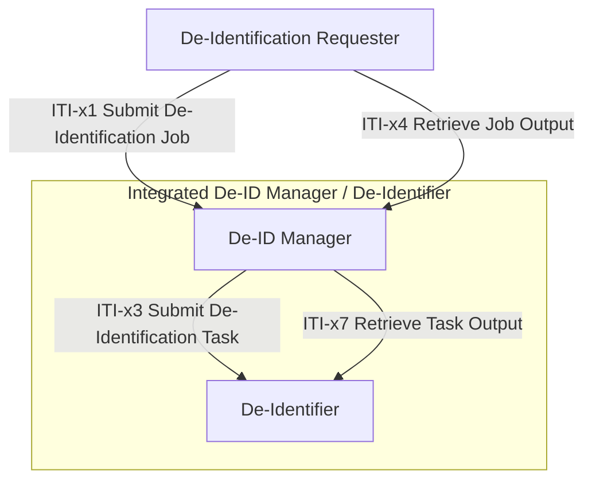

# IHE De-Identification Services (DIS)

[CI Build — rendered Implementation Guide](https://build.fhir.org/ig/IHE/ITI.DIS/branches/master/index.html)

**ITI.DIS** is a joint work item of the IHE [IT Infrastructure (ITI)](https://www.ihe.net/ihe_domains/it_infrastructure/), [Quality, Research, and Public Health (QRPH)](https://www.ihe.net/ihe_domains/quality_research_and_public_health/), and [Patient Care Coordination (PCC)](https://www.ihe.net/ihe_domains/patient_care_coordination/) domains, with ITI as the lead domain.

This repository contains the draft IHE supplement for policy-governed de-identification of HL7 FHIR health data.

## Problem Statement

Health data sharing is expanding across clinical care, secondary research, public health, device development, and AI-enabled workflows. Organizations need to disclose data that have been transformed according to policy, but there is no standard, interoperable workflow for how that de-identification is requested, executed, validated, and delivered.

DIS addresses this by providing a governed, auditable path from authorization to delivery — reducing reliance on manual processes and local one-off agreements.

## Profile Scope

- **Four actors** — De-ID Manager, De-Identifier, De-Identification Requester, Integrated De-ID Manager/De-Identifier
- **Four transactions** — ITI-x1 (Submit De-Identification Job), ITI-x3 (Submit De-Identification Task), ITI-x4 (Retrieve Job Output), ITI-x7 (Retrieve Task Output)
- **A minimum de-id evidence baseline** — 9-element evidence structure carried in HL7 FHIR Provenance
- **A single HL7 FHIR payload binding (DIS-FHIR-Payload)** — covering HL7 FHIR R4 and R5 resources, Bundles, and Bulk Data
- **Synchronous and asynchronous job patterns** — inline output for single-patient workflows, deferred output with polling for multi-patient cohorts

## Use Cases

The following use cases motivate the DIS design. Full narratives, pre-conditions, and process flows are defined in [Volume 1 Section 1:PXX.4.2](input/pagecontent/volume-1.md#1pxx42-use-cases).

| UC | Name | Pattern |
|----|------|---------|
| UC-1 | Cross-Border Epidemiological Study Using IPS+ | Async |
| UC-2 | Multimodal AI/ML Method Development (HL7 FHIR Input-Preparation) | Async |
| UC-3 | Clinical Pathology Order (Pseudonymous Care) | Sync |
| UC-4 | AI-Assisted Clinical Decision Support (Cloud Deployment) | Sync |
| UC-5 | Local Authorized Clinical Document Export | Sync |

## Architecture Overview

DIS defines processing for HL7 FHIR R4 and R5 data. Its workflow resources and APIs use HL7 FHIR R4, independently of the version of the clinical data being de-identified.

The rules for workflow messages, such as job submission, task dispatch, and status reporting, form the **protocol binding**, which is part of the mandatory baseline. The separate **payload binding** (DIS-FHIR-Payload) specifies how clinical data formats and versions are identified, packaged, and matched to supported capabilities. HL7 FHIR R5 payloads travel as serialized content in attachments carried or referenced by R4 resources.

Future payload bindings, such as DIS-DICOM1 and DIS-CDA1, could add non-FHIR formats while retaining the HL7 FHIR R4 workflow. These bindings are outside the current scope.

For asynchronous cohort processing, the Requester supplies a manifest, a list of links to prepared input files. These files use newline-delimited JSON (NDJSON), with one HL7 FHIR resource per line. DIS returns a manifest linking to the de-identified output files. Both input and output use HL7 FHIR Bulk Data file conventions.

DIS applies the following processing and security requirements to these asynchronous cohort workflows:

- **Capability check:** Before dispatching work, the De-ID Manager checks that the participating actors support the required input/output formats and HL7 FHIR versions.
- **Access control:** Input and output file retrieval must be authorized. The payload and transaction bindings will specify the file-access authorization mechanism.
- **All-or-nothing output:** If a job fails, no partial output dataset is released.
- **No protected material:** Manifests and files delivered to recipients exclude confidential salts and other protected transformation material.

### Actors

The following table defines the four DIS actors and their responsibilities.

| Actor | Responsibility |
|-------|---------------|
| **De-ID Manager** | Receives jobs (ITI-x1), validates the de-identification policy carrier, compiles policy into execution plans, dispatches tasks to De-Identifiers (ITI-x3), returns output and evidence. Persists mappings for reversible jobs without a supplied lookup table; uses authoritative Requester-supplied tables without mandatory persistence. |
| **De-Identifier** | Executes assigned tasks, applies supplied mappings or generates salted patient pseudonyms, and returns output and evidence. Its deployment manages the scope salts. For reversible patient hashing it returns a protected generated lookup table to the Manager. |
| **De-Identification Requester** | Submits job with data request authorization and policy carrier; receives output inline (sync) or via ITI-x4 polling (async). Receives the job result in the Requester role. |
| **Integrated De-ID Manager/De-Identifier** | Combines the functionality of the De-ID Manager and De-Identifier into a single actor. Validates policy, compiles execution plans, executes de-identification internally, and produces output and evidence. May operate standalone (content conformance only) or accept external jobs via ITI-x1 with optional async polling via ITI-x4. Does not initiate nor accept ITI-x3. Persists mappings for reversible jobs without a supplied lookup table; uses authoritative Requester-supplied tables without mandatory persistence. |

### Transactions

The following table defines the four DIS transactions.

| Transaction | Pattern | Purpose |
|-------------|---------|---------|
| **ITI-x1** Submit De-Identification Job | Request/response (sync or async) | Present authorization and policy; receive de-identified output or job acceptance |
| **ITI-x3** Submit De-Identification Task | Manager → De-Identifier | Dispatch one de-identification task; return de-identified output and evidence. Not used by the Integrated De-ID Manager/De-Identifier. |
| **ITI-x4** Retrieve Job Output | Requester → Manager | Poll status and retrieve output for an async job |
| **ITI-x7** Retrieve Task Output | Manager → De-Identifier | Retrieve output, evidence, and validation status for a completed task during asynchronous processing. Required when DIS-ASYNC-TASK is supported. Not used by the Integrated De-ID Manager/De-Identifier. |

### Interaction Diagram



The outer box represents the Integrated De-ID Manager/De-Identifier, which combines both roles into a single actor. When integrated, ITI-x3 and ITI-x7 are internal and not externalized as transactions.

ITI-x1 submits a de-identification job as a FHIR R4 `Task` with one authorization and one or more payload-set inputs. ITI-x3 submits a de-identification task as a FHIR R4 `Task` scoped to one assignment. Successful results use R4 `Parameters`. The same manifest-based wire format applies to single-set and multi-set jobs. See the [transaction matrix](input/pagecontent/volume-2.md#grouped-payload-parameters).

## Policy Model

DIS separates policy definition from policy execution. DIS assumes that the Requester can read the policy version approved for each payload set through an implementation-defined mechanism. The request declares the policy canonical URL and version and identifies the permission in the referenced Data Request Authorization. DIS carries the authorization as an ODRL Agreement in a version-specific R4 Contract and the reusable policy and compiled plan as ODRL Sets in R4 Libraries. The Manager verifies that both the declared identity and the policy rules match the approval. The Manager obtains the policy content in one of two ways:

- **Requester-carried content** — optional `policyContent` references a JWS-signed policy Contract carried in a contained Binary. The Manager verifies the signature and matches the Contract's URL and version to the declaration.
- **Manager-resolved content** — when `policyContent` is absent, the Manager resolves the declared version by implementation-defined means, such as a trusted local store or external retrieval.

The Manager validates **authorization consistency**, **integrity**, **content conformance**, and **currency** before acceptance or dispatch. Semantic-Level policies use format-neutral semantic groups and are compiled into payload-specific execution plans. Syntax-Level policies use concrete paths for a declared payload family and version; the Manager validates and packages them as execution plans. The baseline execution plan uses flat, ordered rules, with one task per ruleSet and optional stage ordering; full policy composition is deferred.

For full details, see [Volume 1 Section 1:PXX.4.1](input/pagecontent/volume-1.md#1pxx41-concepts) and [Section 1:PXX.5.3](input/pagecontent/volume-1.md#1pxx53-policy-carrier-integrity).

## Transformation Actions

DIS defines nine operational actions in the `core` action family: `remove`, `redact`, `replace`, `hash`, `truncate-date`, `round`, `truncate`, `date-shift`, and `keep`. Actions are classified by ISO/IEC 20889:2018 techniques; technique categories are distinct from executable action codes. All actions operate at the record level with policy-specified parameters. Dataset-level statistical disclosure control is outside this supplement.

For transformation scope and exclusions, see [Volume 1 Section 1:PXX.4.1](input/pagecontent/volume-1.md#1pxx41-concepts).

## Conformance

DIS defines two conformance layers. **Content conformance** covers the full de-identification pipeline — policy validation, compilation, execution, and evidence production — and is claimed by the Integrated De-ID Manager/De-Identifier, which can operate standalone without external transactions. **Transaction conformance** applies when actors communicate via standardized DIS transactions (ITI-x1, ITI-x3, ITI-x4, ITI-x7).

All DIS actors support the mandatory FHIR payload binding (DIS-FHIR-Payload) for their roles. External transactions use the HL7 FHIR R4 protocol binding. Options include DIS-ASYNC-JOB (asynchronous job processing with job cancellation between Requester and Manager), DIS-ASYNC-TASK (asynchronous task processing with task cancellation between Manager and De-Identifier), and DIS-IRREVERSIBLE/DIS-REVERSIBLE (at least one required by the Manager, De-Identifier, and Integrated actor).

For the full declaration definitions, conformance layers, actor-option matrix, and dependency rules, see [Volume 1 Section 1:PXX.2](input/pagecontent/volume-1.md#1pxx2-dis-actor-options) and [Section 1:PXX.4.1](input/pagecontent/volume-1.md#1pxx41-concepts).

## Standards Alignment

- **ISO/IEC 20889:2018** — De-identification technique taxonomy
- **ISO 25237:2017** — Pseudonymization guidance
- **HL7 FHIR R4** — DIS workflow APIs, resources, and conformance artifacts
- **HL7 FHIR R4 and R5** — Independently versioned processing payloads
- **IHE ATNA / IUA** — Security, identity, authorization, audit
- **SMART on FHIR Backend Services** — System-to-system authorization
- **W3C PROV-O** — Provenance modeling

## Payload Binding Framework

DIS separates the protocol binding from the payload binding. DIS-FHIR-Payload covers HL7 FHIR R4 and R5 processing payloads. Future payload bindings (e.g., DIS-DICOM1, DIS-CDA1, DIS-V2-1) can be developed independently without changes to the HL7 FHIR R4 protocol binding.

For the payload binding architecture, extension model, and illustrative future bindings, see [Volume 1 Section 1:PXX.4.1](input/pagecontent/volume-1.md#1pxx41-concepts) and [Volume 3 FHIR Payload Binding](input/pagecontent/volume-3.md#fhir-payload-binding).

## Potential Extensions

DIS aims for additive expansion that preserves existing contracts where possible:

- **Core additions** — Policy Authority actor, ITI-x5 push delivery, ITI-x6 re-identification, full DIS-EXE1 composable policy model (policy composition, condition evaluation, cross-element constraints, conflict resolution strategies, and selector specificity rules)
- **Payload bindings** — DIS-DICOM1, DIS-CDA1, DIS-V2-1, DIS-OMOP1 (each self-contained, developed independently within the payload binding framework above)
- **Advanced capabilities** — Dataset-level statistical disclosure control, cross-community federation

Explicit versioning and regression tests support compatibility as the profile evolves. Any incompatible change must identify affected contracts, its impact on existing implementations and conformance claims, and migration requirements. Conformance is assessed against the declared profile version and supported options; it is not an unconditional guarantee of conformance to future versions.

## Contact

**Profile Editors:** Alan Zhang, Lori Fourquet

**IHE Domain:** IT Infrastructure (lead), with QRPH and PCC coordination

## Reversible Mapping Arrangements

DIS-REVERSIBLE supports Manager-managed and Requester-supplied mappings. For Manager-managed hashing, the Manager creates or maintains and persists the mapping needed for reversal. For optional AES-FF1 it retains the protected configuration, scope and key-version association needed for authorized reversal. With a supplied table, it uses that table for direct identifiers and need not persist it. Missing required entries cause rejection before acceptance or terminal failure afterward; no generated fallback or partial output is permitted. Lookup-backed `replace` is a core action. AES-FF1 adds the optional `encrypt` action. See Volume 1 §1:PXX.2.2 and Volume 3 §3:PXX.1.7.

The approved policy declares the linkage scope. The Manager validates the scope and copies it into salted execution rules. The De-Identifier’s deployment manages the confidential 16-byte salt and its version. Cross-community identity resolution and salt coordination remain deployment prerequisites. See Volume 1 §1:PXX.4.1 and Volume 3 §3:PXX.1.3.3.

Requester-supplied and generated patient lookup tables share the DIS-LookupTable DocumentReference profile and four-field mapping entry. The Manager pins supplied content per job and retains generated mappings before release when authorized reversal is required. The guide requires valid references in the de-identified FHIR output. See Volume 3 §3:PXX.1.7.

## Build the draft guide

Place an installed FHIR IG Publisher jar at `input-cache/publisher.jar`. Build the guide from the repository root:

```sh
java -jar input-cache/publisher.jar -ig .
```

Keep the Publisher's terminology service enabled for the publication build. An offline build with `-tx n/a` cannot verify external codes such as UN M49 jurisdiction and UCUM units. Read `output/qa.html` for validation and link diagnostics. The draft source includes narrative in `input/pagecontent`, conformance definitions in `input/fsh`, and downloadable content schemas in `input/images/schemas`.

Edit the authoritative FHIR Semantic Group Binding table in Volume 3. Check its group codes against the DIS Semantic Group CodeSystem before publishing changes. The informative catalog CSV is in `input/images/bindings` and its guide is in `input/pagecontent`.

**Published FHIR examples** appear in the guide's artifact index and FHIR example downloads. The [lookup table](input/fsh/LookupTableExamples.fsh) and [evidence](input/fsh/EvidenceExamples.fsh) examples are authored in FSH. SUSHI generates their JSON during the build.

Editable Mermaid figures are in `input/images-source` and the guide uses the matching PNG files in `input/images`. After editing a figure, render it again with Mermaid CLI using the same filename, a white background, and 2× scale.
