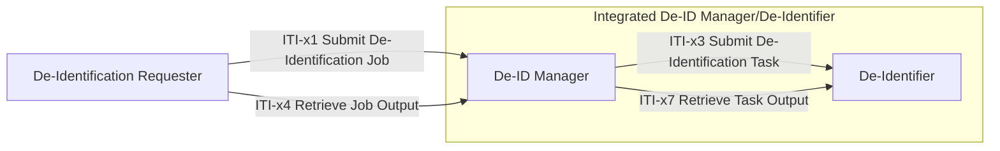

# IHE De-Identification Services (DIS) — Phase 1

**ITI.DIS** is a joint work item of the IHE [IT Infrastructure (ITI)](https://www.ihe.net/ihe_domains/it_infrastructure/), [Quality, Research, and Public Health (QRPH)](https://www.ihe.net/ihe_domains/quality_research_and_public_health/), and [Patient Care Coordination (PCC)](https://www.ihe.net/ihe_domains/patient_care_coordination/) domains, with ITI as the lead domain.

**This repository focuses on Phase 1 scope** — a complete, testable interoperability specification for policy-governed de-identification of HL7 FHIR health data. Additional payload bindings (CDA, DICOM, HL7 v2) and advanced capabilities (re-identification, push delivery, policy retrieval) are planned for future phases, with preservation of Phase 1 contracts as a design objective.

## Problem Statement

Health data sharing is expanding across clinical care, secondary research, public health, device development, and AI-enabled workflows. Organizations need to disclose data that have been transformed according to policy, but there is no standard, interoperable workflow for how that de-identification is requested, executed, validated, and delivered.

DIS addresses this by providing a governed, auditable path from authorization to delivery — reducing reliance on manual processes and local one-off agreements.

## What Phase 1 Delivers

- **Four actors** — De-ID Manager, De-Identifier, De-Identification Requester, Integrated De-ID Manager/De-Identifier
- **Four transactions** — ITI-x1 (Submit Job), ITI-x3 (Submit Task), ITI-x4 (Retrieve Job Output), ITI-x7 (Retrieve Task Output)
- **A baseline policy execution model** — flat, ordered rule lists (DIS-BASELINE-EXEC), with a separate plan for each stage in multi-stage workflows
- **A minimum de-id evidence baseline** — 9-element evidence structure carried in FHIR Provenance
- **A single FHIR payload binding (DIS-FHIR-Payload)** — covering R4/R5/R6 resources, Bundles, and Bulk Data
- **Synchronous and asynchronous job patterns** — inline output for single-patient workflows, deferred output with polling for multi-patient cohorts

## Use Cases

| UC | Name | Pattern | Description |
|----|------|---------|-------------|
| UC-1 | Cross-Border Epidemiological Study Using IPS+ | Async | Cohort dataset transformed using pseudonymization and policy-specified record-level rules for a cross-border cancer study |
| UC-2 | Multimodal AI/ML Method Development (FHIR input-preparation) | Async | De-identification of structured clinical data for a training-ready multimodal dataset |
| UC-3 | Clinical Pathology Order (Pseudonymous Care) | Sync | Pseudonymization before sending a lab order to an external pathology lab |
| UC-4 | AI-Assisted Clinical Decision Support (Cloud Deployment) | Sync | Pseudonymization before transmitting patient data to a cloud-hosted AI service |
| UC-5 | Local Authorized Clinical Document Export | Sync | Clinician-initiated export of a de-identified FHIR document Bundle |

## Architecture Overview

DIS is built on a modular, binding-neutral core architecture. Phase 1 specifies a FHIR R4 protocol binding (DIS-FHIR-Job, DIS-FHIR-Task, DIS-FHIR-JobStatus) that is content-neutral — the same R4 protocol layer can orchestrate de-identification of any payload type. The workflow resources and APIs use R4 exclusively, while the processing payload may be any data format for which a payload binding is declared. DIS-FHIR-Payload supports independently versioned FHIR R4, R5, and R6 processing payloads; future payload bindings (e.g., DIS-DICOM1, DIS-CDA1) will support non-FHIR data formats within the same R4 protocol layer. The IG configuration targets the DIS-defined FHIR artifacts; it does not restrict processing payloads to that release or format.

Payload format identification, version identification, packaging, and capability matching are specified separately from the R4 protocol binding in each payload binding. FHIR R5 and R6 payloads are referenced or carried as explicitly identified serialized content, rather than embedded as native resources of those versions in an R4 envelope. Non-FHIR payloads (DICOM, CDA) are carried or referenced using their respective payload binding's packaging rules. Processing payloads of any format require format-specific examples and validation tests, not a different version of the DIS protocol binding. Bulk Data supports both input and output for asynchronous cohort jobs through manifests referencing NDJSON files. Requesters supply prepared input references; the Manager returns de-identified output and evidence references. Source-system export remains outside DIS. File retrieval requires authorization, payload versions and formats are checked against declared capabilities, and failed jobs release no partial dataset. Recipient-facing manifests and files exclude seeds and other protected transformation material. Exact manifest fields, retrieval behavior, and evidence packaging remain binding work; using Bulk Data file conventions does not by itself claim conformance to the full HL7 Bulk Data API.

### Actors

| Actor | Responsibility |
|-------|---------------|
| **De-ID Manager** | Receives jobs (ITI-x1), validates the de-identification policy carrier, compiles policy into execution plans, dispatches tasks to De-Identifiers (ITI-x3), returns output and evidence. Sole persistent custodian of identity mappings and reversibility records. |
| **De-Identifier** | Executes assigned de-identification tasks. Stateless with respect to reversibility — receives scoped, purpose-specific seeds as needed, derives transformation values according to declared capabilities, produces transformations and evidence, and retains no seeds or identity-linking material after task termination. |
| **De-Identification Requester** | Submits job with data request authorization and policy carrier; receives output inline (sync) or via ITI-x4 polling (async). Grouped with the De-Identified Data Receiver in Phase 1. |
| **Integrated De-ID Manager/De-Identifier** | Combines the functionality of the De-ID Manager and De-Identifier into a single actor. Receives jobs (ITI-x1), validates policy, compiles execution plans, executes de-identification internally, and returns output and evidence. Does not initiate nor accept ITI-x3. Sole persistent custodian of identity mappings and reversibility records. |

The Manager may share seeds containing no PII with authorized De-Identifiers over protected channels, including across deployment trust boundaries. Seeds are protected transformation material and are not disclosed to data recipients. A shared trust boundary is optional.

The `consistencyKey` identifies an authorized linkage scope; it is separate from secret seeds and protected transformation parameters. The Manager manages scope authorization and seed lifecycle, while the De-Identifier derives pseudonyms and date-shift values. Consistent results also require compatible identity resolution, derivation methods, versions, and parameters.

### Transactions

| Transaction | Pattern | Purpose |
|-------------|---------|---------|
| **ITI-x1** Submit De-Identification Job | Request/response (sync or async) | Present authorization and policy; receive de-identified output or job acceptance |
| **ITI-x3** Submit De-Identification Task | Manager → De-Identifier | Dispatch one de-identification task; return de-identified output and evidence. Not used by the Integrated De-ID Manager/De-Identifier. |
| **ITI-x4** Retrieve Job Output | Requester → Manager | Poll status and retrieve output for an async job |
| **ITI-x7** Retrieve Task Output | Manager → De-Identifier | Retrieve output, evidence, and validation status for a completed task during asynchronous processing. Required when DIS-ASYNC is supported. Not used by the Integrated De-ID Manager/De-Identifier. |

### Interaction Diagram

The outer box represents the Integrated De-ID Manager/De-Identifier, which combines both roles into a single actor. When integrated, ITI-x3 and ITI-x7 are internal and not externalized as transactions.

## Policy Model

Phase 1 supports three policy carrier variants in ITI-x1:

| Variant | Description |
|---------|-------------|
| **Inline** | Signed policy artifact embedded directly in the request |
| **By reference** | Reference pointing to a signed policy artifact stored externally |
| **Named standardized policy** | Policy identifier and any required version, resolved by the Manager to a specific signed policy artifact |

The De-ID Manager validates every carrier for **signature validity**, **schema conformance**, **currency**, and **authorization consistency** before compiling it into a payload-specific execution plan.

The Manager is responsible for resolving named policies unambiguously to specific, versioned, signed artifacts before acceptance. Resolution may use local configuration, a registry, or an external source; the mechanism is implementation-defined. Unresolved, ambiguous, or invalid policies cause synchronous rejection. Locally configured policies, including DIS-LOCAL-EXPORT policies, undergo the same four validation checks. The De-Identifier receives the compiled plan; native named-policy execution requires a capability match for the resolved policy and version.

### Named Standardized Policies

DIS can reference named policies defined by existing standards. Externally standardized policies such as:

| Named Policy | Defining Standard |
|---|---|
| `dicom:basic-profile` | DICOM PS 3.15 Appendix E — Basic Application Level Confidentiality Profile |
| `dicom:retain-long-full-dates` | DICOM PS 3.15 Appendix E — Retain Longitudinal Temporal Information with Full Dates Option |
| `dicom:retain-patient-chars` | DICOM PS 3.15 Appendix E — Retain Patient Characteristics Option |
| `dicom:retain-device-id` | DICOM PS 3.15 Appendix E — Retain Device Identity Option |

However, supporting DICOM including relevant named policies is out of the scope of DIS phase 1

Adopters MAY define their own named policies for use-case-specific needs (e.g., pseudonymization for multi-site research, clinical trial export, teaching files, AI training) using the Phase 1 baseline policy execution model. These are adopter-defined — DIS does not itself author named policies without a grounding standard.

## Transformation Actions

Phase 1 requires support for 9 Core actions aligned with ISO/IEC 20889:2018:

`dis:local-suppression` · `dis:masking` · `dis:retain` · `dis:pseudonymize` · `dis:rounding` · `dis:top-bottom-coding` · `dis:combine-attributes` · `dis:local-generalization` · `dis:noise-addition`

Phase 1 excludes dataset- or database-level de-identification actions, including small-cell handling and suppression or generalization that requires computing cohort statistics. Multi-patient and Bulk Data workflows remain in scope for applying supported record-level rules. Generalization, suppression, and noise addition use policy-specified parameters rather than parameters calculated from the cohort. Dataset-level statistical disclosure control is deferred to a future phase.

## Conformance

A conformant Phase 1 implementation declares the specific claims it supports. The table below defines each declaration.

### Base Declarations (required for all implementations)

| Declaration | Applies to | Description | Dependency |
|-------------|-----------|-------------|------------|
| **DIS-BASE** | All actors | Synchronous job support — the minimum operational capability for any DIS implementation | None |
| **DIS-BASELINE-EXEC** | Manager, De-Identifier, Integrated | Flat, ordered rule lists carried as FHIR Library resources. Excludes policy composition, condition evaluation, cross-element constraints, conflict resolution strategies, and selector specificity rules. Full DIS-EXE1 is deferred. | DIS-BASE |

### FHIR Protocol and Payload Bindings

| Declaration | Applies to | Description | Dependency |
|-------------|-----------|-------------|------------|
| **DIS-FHIR-Job** | Requester, Manager, Integrated | FHIR R4 protocol binding for ITI-x1 (`POST [base]/$submit-dis-job` with FHIR R4 Parameters). Content-neutral — can orchestrate any payload type (FHIR, DICOM, CDA, or other formats). | DIS-BASE |
| **DIS-FHIR-Task** | Manager, De-Identifier | FHIR R4 protocol binding for ITI-x3 (FHIR R4 Task REST). Task references a Library containing DIS-EXE1 rules, the processing target, and a cryptographic seed. Does not apply to the Integrated De-ID Manager/De-Identifier. | DIS-BASE |
| **DIS-FHIR-Payload** | All actors | FHIR payload binding — defines the content model (FHIRPath addressing, resource traversal, narrative handling, Provenance-based evidence) and data-plane access (FHIR REST read/write or inline by-value). Covers independently versioned FHIR R4, R5, and R6 processing payloads. The processing payload version is independent of the R4 protocol binding. | DIS-FHIR-Job |
| **DIS-FHIR-JobStatus** | Requester, Manager, Integrated | FHIR R4 protocol binding for ITI-x4 (FHIR Asynchronous Request Pattern — `GET` on `Content-Location` URL). | DIS-ASYNC |

### Optional Capabilities

| Declaration | Applies to | Description | Dependency |
|-------------|-----------|-------------|------------|
| **DIS-ASYNC** | Requester, Manager, Integrated | Asynchronous job processing — the Manager returns `202 Accepted` with a polling URL; the Requester retrieves output via ITI-x4; the Manager retrieves task output via ITI-x7. Required for multi-patient cohort workflows. | Both participating Requester and Manager (or Integrated actor) declare support; ITI-x4, ITI-x7, and DIS-FHIR-JobStatus required. ITI-x7 does not apply to the Integrated actor. |
| **DIS-LOCAL-EXPORT** | Manager, Integrated | Local authorized export — maps a clinician's local authorization (role + purpose) to a configured, signed, versioned de-identification policy using the DIS-LOCAL-EXPORT bridge pattern. No external policy carrier acquisition required; all four validation checks still apply. | DIS-BASE |
| **DIS-IRREVERSIBLE** | Manager, De-Identifier, Integrated | Irreversible de-identification — the baseline pseudonymization mode. No reversibility material is retained. | At least one of DIS-IRREVERSIBLE or DIS-REVERSIBLE SHALL be declared |
| **DIS-REVERSIBLE** | Manager, De-Identifier, Integrated | Reversible pseudonymization — the Manager retains the identity table (seed-to-patient mapping) and pseudonym index for future re-identification without re-processing. Requires both participating Manager and De-Identifier to declare support, or the Integrated actor declares it as a single actor. Phase 1 does not standardize re-identification transactions. | At least one of DIS-IRREVERSIBLE or DIS-REVERSIBLE SHALL be declared; DIS-REVERSIBLE requires both sides |

See the [Volume 1 declaration matrix](input/pagecontent/volume-1.md#actor-options) for actor obligations and option dependencies.

### Actor-Option Matrix

The following matrix consolidates all declarations and their applicability per actor. **R** = Required, **O** = Optional, **C** = Conditional, **—** = Not applicable.

| Declaration | Requester | Manager | De-Identifier | Integrated |
|-------------|-----------|---------|---------------|------------|
| **DIS-BASE** | R | R | R | R |
| **DIS-BASELINE-EXEC** | — | R | R | R |
| **DIS-FHIR-Job** | R | R | — | R |
| **DIS-FHIR-Task** | — | R | R | — |
| **DIS-FHIR-Payload** | R | R | R | R |
| **DIS-FHIR-JobStatus** | C | C | — | C |
| **DIS-ASYNC** | O | O | — | O |
| **DIS-LOCAL-EXPORT** | — | O | — | O |
| **DIS-IRREVERSIBLE** | — | O | O | O |
| **DIS-REVERSIBLE** | — | O | O | O |

- **R** — Required for all Phase 1 implementations of this actor.
- **O** — Optional; declared when the actor supports this capability.
- **C** — Conditional; required when a dependent option is declared (DIS-FHIR-JobStatus requires DIS-ASYNC).
- **—** — Not applicable to this actor.

In Phase 1, the FHIR R4 protocol bindings (DIS-FHIR-Job, DIS-FHIR-Task, DIS-FHIR-JobStatus) are required for all applicable actors since FHIR R4 is the only available protocol binding. The protocol layer is content-neutral and can orchestrate any payload type. DIS-FHIR-Payload is required for all actors as the only available payload binding, covering independently versioned FHIR R4, R5, and R6 processing payloads. Future payload bindings (e.g., DIS-DICOM1, DIS-CDA1) can be declared alongside DIS-FHIR-Payload to support additional data formats within the same R4 protocol layer. At least one of DIS-IRREVERSIBLE or DIS-REVERSIBLE SHALL be declared by the Manager, De-Identifier, and Integrated actor.

## Standards Alignment

- **ISO/IEC 20889:2018** — De-identification technique taxonomy
- **ISO 25237:2017** — Pseudonymization guidance
- **HL7 FHIR R4** — Initial DIS workflow APIs, resources, and conformance artifacts
- **HL7 FHIR R4/R5/R6** — Independently versioned processing payloads
- **IHE ATNA / IUA** — Security, identity, authorization, audit
- **SMART on FHIR Backend Services** — System-to-system authorization
- **W3C PROV-O** — Provenance modeling

## Payload Binding Framework

DIS separates the protocol binding from the payload binding so that additional data formats can be supported without changing the protocol layer. The FHIR R4 protocol binding is content-neutral — it carries or references payloads of any format. Each payload binding is a self-contained specification that defines format-specific content models, transformation action mapping, data-plane access, evidence mapping, version identification, and packaging rules for a particular data format family.

Phase 1 defines DIS-FHIR-Payload as the initial payload binding. The following table illustrates how the framework extends to additional data formats. Future payload bindings are not defined in Phase 1 and are provided for informational purposes.

| Payload Binding | Data Format | Content Model | Packaging Approach |
|-----------------|-------------|---------------|--------------------|
| **DIS-FHIR-Payload** (Phase 1) | HL7 FHIR R4, R5, R6 | FHIRPath addressing, resource traversal, narrative handling | Inline FHIR resources or by-reference via FHIR REST / Bulk Data manifests |
| **DIS-DICOM1** (future) | DICOM | DICOM tag paths, sequence item traversal, pixel data handling | By-reference via DICOMweb WADO-RS or as DICOM Part 10 binary attachments |
| **DIS-CDA1** (future) | HL7 CDA R2 | XPath / CDA document model, section and entry traversal, narrative block handling | Inline XML or by-reference as document attachments |
| **DIS-V2-1** (future) | HL7 v2.x | Segment/field/component paths (e.g., PID-5, OBX-5) | By-reference or inline as ER7/XML-encoded messages |

An actor declares which payload bindings it supports. The De-ID Manager verifies payload binding compatibility before dispatching tasks. Each future payload binding is developed independently — it does not require changes to the R4 protocol binding or to previously defined payload bindings. This enables parallel development by different IHE domains and incremental adoption by implementations.

## Phase 1 Expansion Path

DIS aims for additive expansion that preserves existing Phase 1 contracts where possible:

- **Core additions** — Policy Authority actor, ITI-x5 push delivery, ITI-x6 re-identification, full DIS-EXE1 composable policy model (policy composition, condition evaluation, cross-element constraints, conflict resolution strategies, and selector specificity rules)
- **Payload bindings** — DIS-DICOM1, DIS-CDA1, DIS-V2-1, DIS-OMOP1 (each self-contained, developed independently within the payload binding framework above)
- **Advanced capabilities** — Dataset-level statistical disclosure control, cross-community federation

Compatibility with Phase 1 is a design objective, supported by explicit versioning and regression tests. Future additions should preserve existing contracts where possible. Any incompatible change must identify affected contracts, its impact on existing implementations and conformance claims, and migration requirements. Conformance is assessed against the declared profile version and supported options; it is not an unconditional guarantee of conformance to future versions.

## Contact

**Profile Editors:** Alan Zhang, Lori Fourquet

**IHE Domain:** IT Infrastructure (lead), with QRPH and PCC coordination
