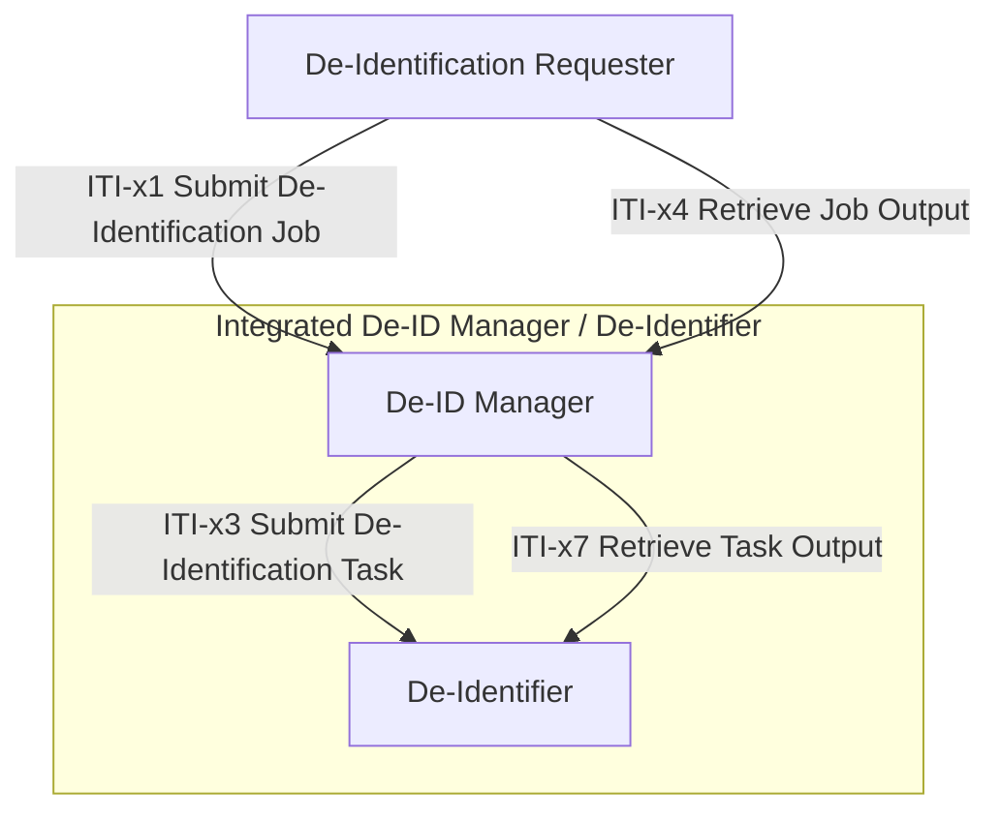

# IHE De-Identification Services (DIS) — Phase 1

**ITI.DIS** is a joint work item of the IHE [IT Infrastructure (ITI)](https://www.ihe.net/ihe_domains/it_infrastructure/), [Quality, Research, and Public Health (QRPH)](https://www.ihe.net/ihe_domains/quality_research_and_public_health/), and [Patient Care Coordination (PCC)](https://www.ihe.net/ihe_domains/patient_care_coordination/) domains, with ITI as the lead domain.

**This repository focuses on Phase 1 scope** — a complete, testable interoperability specification for policy-governed de-identification of HL7 FHIR health data. Additional payload bindings (CDA, DICOM, HL7 v2) and advanced capabilities (re-identification, push delivery, policy retrieval) are planned for future phases, with preservation of Phase 1 contracts as a design objective.

## Problem Statement

Health data sharing is expanding across clinical care, secondary research, public health, device development, and AI-enabled workflows. Organizations need to disclose data that have been transformed according to policy, but there is no standard, interoperable workflow for how that de-identification is requested, executed, validated, and delivered.

DIS addresses this by providing a governed, auditable path from authorization to delivery — reducing reliance on manual processes and local one-off agreements.

## What Phase 1 Delivers

- **Four actors** — De-ID Manager, De-Identifier, De-Identification Requester, Integrated De-ID Manager/De-Identifier
- **Four transactions** — ITI-x1 (Submit Job), ITI-x3 (Submit Task), ITI-x4 (Retrieve Job Output), ITI-x7 (Retrieve Task Output)
- **A minimum de-id evidence baseline** — 9-element evidence structure carried in HL7 FHIR Provenance
- **A single HL7 FHIR payload binding (DIS-FHIR-Payload)** — covering HL7 FHIR R4/R5/R6 resources, Bundles, and Bulk Data
- **Synchronous and asynchronous job patterns** — inline output for single-patient workflows, deferred output with polling for multi-patient cohorts

## Use Cases

The following use cases motivate the Phase 1 design. Full narratives, pre-conditions, and process flows are defined in [Volume 1 Section 1:PXX.4.2](input/pagecontent/volume-1.md#1pxx42-use-cases).

| UC | Name | Pattern |
|----|------|---------|
| UC-1 | Cross-Border Epidemiological Study Using IPS+ | Async |
| UC-2 | Multimodal AI/ML Method Development (HL7 FHIR Input-Preparation) | Async |
| UC-3 | Clinical Pathology Order (Pseudonymous Care) | Sync |
| UC-4 | AI-Assisted Clinical Decision Support (Cloud Deployment) | Sync |
| UC-5 | Local Authorized Clinical Document Export | Sync |

## Architecture Overview

Phase 1 processes only HL7 FHIR R4, R5, and R6 data. Its workflow resources and APIs use HL7 FHIR R4, independently of the version of the clinical data being de-identified.

The rules for workflow messages, such as job submission, task dispatch, and status reporting, form the **protocol binding**, which is part of the mandatory baseline. The separate **payload binding** (DIS-FHIR-Payload) specifies how clinical data formats and versions are identified, packaged, and matched to supported capabilities. R6 payload support follows the ballot draft identified by Volume 1 and remains subject to confirmation upon final publication. HL7 FHIR R5 and R6 data are carried as serialized content explicitly labelled with their HL7 FHIR version, not embedded as native resources in an HL7 FHIR R4 envelope.

Future payload bindings, such as DIS-DICOM1 and DIS-CDA1, could add non-FHIR formats while retaining the HL7 FHIR R4 workflow. These bindings are outside the current scope.

For asynchronous cohort processing, the Requester supplies a manifest, a list of links to prepared input files. These files use newline-delimited JSON (NDJSON), with one HL7 FHIR resource per line. DIS returns a manifest linking to the de-identified output files. Both input and output use HL7 FHIR Bulk Data file conventions.

DIS applies the following processing and security requirements to these asynchronous cohort workflows:

- **Capability check:** Before dispatching work, the De-ID Manager checks that the participating actors support the required input/output formats and HL7 FHIR versions.
- **Access control:** Input and output file retrieval must be authorized. The payload and transaction bindings will specify the file-access authorization mechanism.
- **All-or-nothing output:** If a job fails, no partial output dataset is released.
- **No protected material:** Manifests and files delivered to recipients never contain seeds or other protected transformation material.

### Actors

The following table defines the four DIS actors and their responsibilities.

| Actor | Responsibility |
|-------|---------------|
| **De-ID Manager** | Receives jobs (ITI-x1), validates the de-identification policy carrier, compiles policy into execution plans, dispatches tasks to De-Identifiers (ITI-x3), returns output and evidence. Persists mappings for reversible jobs without a supplied lookup table; uses authoritative Requester-supplied tables without mandatory persistence. |
| **De-Identifier** | Executes assigned de-identification tasks. Stateless with respect to reversibility — receives scoped, purpose-specific seeds as needed, derives transformation values according to declared capabilities, produces transformations and evidence, and retains no seeds or identity-linking material after task termination. |
| **De-Identification Requester** | Submits job with data request authorization and policy carrier; receives output inline (sync) or via ITI-x4 polling (async). Grouped with the De-Identified Data Receiver in Phase 1. |
| **Integrated De-ID Manager/De-Identifier** | Combines the functionality of the De-ID Manager and De-Identifier into a single actor. Validates policy, compiles execution plans, executes de-identification internally, and produces output and evidence. May operate standalone (content conformance only) or accept external jobs via ITI-x1 with optional async polling via ITI-x4. Does not initiate nor accept ITI-x3. Persists mappings for reversible jobs without a supplied lookup table; uses authoritative Requester-supplied tables without mandatory persistence. |

### Transactions

The following table defines the four Phase 1 transactions.

| Transaction | Pattern | Purpose |
|-------------|---------|---------|
| **ITI-x1** Submit De-Identification Job | Request/response (sync or async) | Present authorization and policy; receive de-identified output or job acceptance |
| **ITI-x3** Submit De-Identification Task | Manager → De-Identifier | Dispatch one de-identification task; return de-identified output and evidence. Not used by the Integrated De-ID Manager/De-Identifier. |
| **ITI-x4** Retrieve Job Output | Requester → Manager | Poll status and retrieve output for an async job |
| **ITI-x7** Retrieve Task Output | Manager → De-Identifier | Retrieve output, evidence, and validation status for a completed task during asynchronous processing. Required when DIS-ASYNC-TASK is supported. Not used by the Integrated De-ID Manager/De-Identifier. |

### Interaction Diagram

The outer box represents the Integrated De-ID Manager/De-Identifier, which combines both roles into a single actor. When integrated, ITI-x3 and ITI-x7 are internal and not externalized as transactions.

## Policy Model

DIS separates policy definition from policy execution. Every ITI-x1 request declares the approved policy by canonical URL and version, alongside the data request authorization that approves that policy. Policy content is obtained in one of two ways:

- **Requester-carried content** — optional `policy.content` carries a JWS-signed policy Library as a Binary resource. The Manager verifies the signature and matches the Library's URL and version to the declaration.
- **Manager-resolved content** — when `policy.content` is absent, the Manager resolves the declared policy through its own trust model, such as an administratively provisioned store or trusted external retrieval. A JWS signature is not required for every locally provisioned policy.

The Manager validates **authorization consistency**, **integrity**, **schema conformance**, and **currency** before acceptance or dispatch. Semantic-Level policies use format-neutral semantic groups and are compiled into payload-specific execution plans. Syntax-Level policies use concrete paths for a declared payload family and version; the Manager validates and packages them as execution plans. Phase 1 uses flat, ordered rules, with one task per ruleSet and optional stage ordering; full policy composition is deferred.

For full details, see [Volume 1 Section 1:PXX.4.1](input/pagecontent/volume-1.md#1pxx41-concepts) and [Section 1:PXX.5.3](input/pagecontent/volume-1.md#1pxx53-policy-carrier-integrity).

## Transformation Actions

Phase 1 defines nine operational actions in the `core` action family: `remove`, `redact`, `replace`, `hash`, `truncate-date`, `round`, `truncate`, `date-shift`, and `keep`. Actions are classified by ISO/IEC 20889:2018 techniques; technique categories are distinct from executable action codes. All actions operate at the record level with policy-specified parameters. Dataset-level statistical disclosure control is deferred to a future phase.

For transformation scope and exclusions, see [Volume 1 Section 1:PXX.4.1](input/pagecontent/volume-1.md#1pxx41-concepts).

## Conformance

DIS defines two conformance layers. **Content conformance** covers the full de-identification pipeline — policy validation, compilation, execution, and evidence production — and is claimed by the Integrated De-ID Manager/De-Identifier, which can operate standalone without external transactions. **Transaction conformance** applies when actors communicate via standardized DIS transactions (ITI-x1, ITI-x3, ITI-x4, ITI-x7).

All DIS actors implement the HL7 FHIR R4 protocol binding as a mandatory baseline. Options include DIS-FHIR-Payload (required in Phase 1 as the only payload binding), DIS-ASYNC-JOB (asynchronous job processing between Requester and Manager), DIS-ASYNC-TASK (asynchronous task processing between Manager and De-Identifier), and DIS-IRREVERSIBLE/DIS-REVERSIBLE (at least one required by the Manager, De-Identifier, and Integrated actor).

For the full declaration definitions, conformance layers, actor-option matrix, and dependency rules, see [Volume 1 Section 1:PXX.2](input/pagecontent/volume-1.md#1pxx2-dis-actor-options) and [Section 1:PXX.4.1](input/pagecontent/volume-1.md#1pxx41-concepts).

## Standards Alignment

- **ISO/IEC 20889:2018** — De-identification technique taxonomy
- **ISO 25237:2017** — Pseudonymization guidance
- **HL7 FHIR R4** — Initial DIS workflow APIs, resources, and conformance artifacts
- **HL7 FHIR R4/R5/R6** — Independently versioned processing payloads
- **IHE ATNA / IUA** — Security, identity, authorization, audit
- **SMART on FHIR Backend Services** — System-to-system authorization
- **W3C PROV-O** — Provenance modeling

## Payload Binding Framework

DIS separates the protocol binding from the payload binding. Phase 1 defines DIS-FHIR-Payload as the initial payload binding, covering HL7 FHIR R4, R5, and R6 processing payloads. Future payload bindings (e.g., DIS-DICOM1, DIS-CDA1, DIS-V2-1) can be developed independently without changes to the HL7 FHIR R4 protocol binding.

For the payload binding architecture, extension model, and illustrative future bindings, see [Volume 1 Section 1:PXX.4.1](input/pagecontent/volume-1.md#1pxx41-concepts) and [Volume 3 Section 3:PXX.1](input/pagecontent/volume-3.md#3pxx1-dis-fhir-payload-content-module).

## Phase 1 Expansion Path

DIS aims for additive expansion that preserves existing Phase 1 contracts where possible:

- **Core additions** — Policy Authority actor, ITI-x5 push delivery, ITI-x6 re-identification, full DIS-EXE1 composable policy model (policy composition, condition evaluation, cross-element constraints, conflict resolution strategies, and selector specificity rules)
- **Payload bindings** — DIS-DICOM1, DIS-CDA1, DIS-V2-1, DIS-OMOP1 (each self-contained, developed independently within the payload binding framework above)
- **Advanced capabilities** — Dataset-level statistical disclosure control, cross-community federation

Compatibility with Phase 1 is a design objective, supported by explicit versioning and regression tests. Future additions should preserve existing contracts where possible. Any incompatible change must identify affected contracts, its impact on existing implementations and conformance claims, and migration requirements. Conformance is assessed against the declared profile version and supported options; it is not an unconditional guarantee of conformance to future versions.

## Contact

**Profile Editors:** Alan Zhang, Lori Fourquet

**IHE Domain:** IT Infrastructure (lead), with QRPH and PCC coordination

## Reversible Mapping Arrangements

DIS-REVERSIBLE supports Manager-managed and Requester-supplied mappings. Without a supplied table, the Manager creates or maintains and persists the mapping needed for reversal. With a supplied table, it uses that table for direct identifiers and need not persist it. Missing required entries cause rejection before acceptance or terminal failure afterward; no generated fallback or partial output is permitted. Lookup-backed `replace` retains the nine-action vocabulary. See Volume 1 §1:PXX.2.2 and Volume 3 §3:PXX.1.7.

Cross-community pseudonym consistency requires identity resolution, shared-scope authorization and coordinated derivation/seed lifecycle arrangements established by the deployment outside DIS. DIS does not standardize those arrangements, and a shared identity-linkage-scope alone does not establish cross-community consistency. See Volume 1 §1:PXX.4.1.

The De-Identifier performs pseudonym generation or lookup-backed replacement and reference updates; the Manager controls mappings and derivation material. Supplied tables must be authorized by approved lookup-backed rules and never override a hash/fixed-value policy. Irreversible mode maintains no reverse-mapping table; retained secrets for authorized cross-job consistency remain a reproduction/linkage risk governed by policy. The baseline patient derivation contract is in Volume 3 §3:PXX.1.3.3; the task subject/seed carrier, separate resource-ID derivation and worked examples are defined in Volume 3 §§3:PXX.1.3.4–5 and §3:PXX.1.8.

Lookup tables are persistent identified DIS-LookupTable DocumentReference resources. Their JSON content is inline or in a protected Binary. Job/task submissions carry references, and the Manager pins exact metadata/content for each job. Requester repository persistence does not require Manager persistence of supplied-table copies. See Volume 3 §3:PXX.1.7.

## Build the draft guide

Run `./_build.sh` for the local Publisher workflow. With Docker, use `./ig-run` from the repository root. The Docker workflow uses local SUSHI, a Publisher jar at `input-cache/publisher.jar` or `PUBLISHER_JAR`, and a local `hl7fhir/ig-publisher-base:latest` image. Set `PUBLISHER_IMAGE` for a different installed image. Set `ONLINE_TX=1` to enable remote terminology validation.

Read `output/qa.html` for validation and link diagnostics. The draft source includes narrative in `input/pagecontent`, conformance definitions in `input/fsh`, and downloadable content schemas in `input/images/schemas`.

**Published FHIR examples** appear in the guide's artifact index and FHIR example downloads. The [lookup table](input/fsh/LookupTableExamples.fsh) and [evidence](input/fsh/EvidenceExamples.fsh) examples are authored in FSH. SUSHI generates their JSON during the build.

Editable Mermaid figures are in `input/images-source` and the guide uses the matching PNG files in `input/images`. After editing a figure, render it again with Mermaid CLI using the same filename, a white background, and 2× scale.
