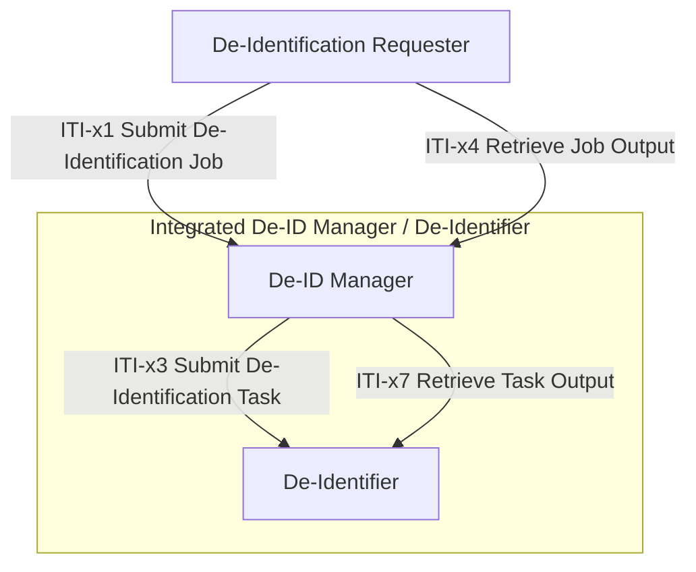

# IHE De-Identification Services (DIS) — Phase 1

**ITI.DIS** is a joint work item of the IHE [IT Infrastructure (ITI)](https://www.ihe.net/ihe_domains/it_infrastructure/), [Quality, Research, and Public Health (QRPH)](https://www.ihe.net/ihe_domains/quality_research_and_public_health/), and [Patient Care Coordination (PCC)](https://www.ihe.net/ihe_domains/patient_care_coordination/) domains, with ITI as the lead domain.

**This repository focuses on Phase 1 scope** — a complete, testable interoperability specification for policy-governed de-identification of HL7 FHIR health data. Additional payload bindings (CDA, DICOM, HL7 v2) and advanced capabilities (re-identification, push delivery, policy retrieval) are planned for future phases, with preservation of Phase 1 contracts as a design objective.

## Problem Statement

Health data sharing is expanding across clinical care, secondary research, public health, device development, and AI-enabled workflows. Organizations need to disclose data that have been transformed according to policy, but there is no standard, interoperable workflow for how that de-identification is requested, executed, validated, and delivered.

DIS addresses this by providing a governed, auditable path from authorization to delivery — reducing reliance on manual processes and local one-off agreements.

## What Phase 1 Delivers

- **Four actors** — De-ID Manager, De-Identifier, De-Identification Requester, Integrated De-ID Manager/De-Identifier
- **Four transactions** — ITI-x1 (Submit Job), ITI-x3 (Submit Task), ITI-x4 (Retrieve Job Output), ITI-x7 (Retrieve Task Output)
- **A minimum de-id evidence baseline** — 9-element evidence structure carried in HL7 FHIR Provenance
- **A single HL7 FHIR payload binding (DIS-FHIR-Payload)** — covering HL7 FHIR R4/R5/R6 resources, Bundles, and Bulk Data
- **Synchronous and asynchronous job patterns** — inline output for single-patient workflows, deferred output with polling for multi-patient cohorts

## Use Cases

The following use cases motivate the Phase 1 design. Full narratives, pre-conditions, and process flows are defined in [Volume 1 Section 1:PXX.4.2](input/pagecontent/volume-1.md#1pxx42-use-cases).

| UC | Name | Pattern |
|----|------|---------|
| UC-1 | Cross-Border Epidemiological Study Using IPS+ | Async |
| UC-2 | Multimodal AI/ML Method Development (HL7 FHIR Input-Preparation) | Async |
| UC-3 | Clinical Pathology Order (Pseudonymous Care) | Sync |
| UC-4 | AI-Assisted Clinical Decision Support (Cloud Deployment) | Sync |
| UC-5 | Local Authorized Clinical Document Export | Sync |

## Architecture Overview

Phase 1 processes only HL7 FHIR R4, R5, and R6 data. Its workflow resources and APIs use HL7 FHIR R4, independently of the version of the clinical data being de-identified.

The rules for workflow messages, such as job submission, task dispatch, and status reporting, form the **protocol binding**, which is part of the mandatory baseline. The separate **payload binding** (DIS-FHIR-Payload) specifies how clinical data formats and versions are identified, packaged, and matched to supported capabilities. HL7 FHIR R5 and R6 data are carried as serialized content explicitly labelled with their HL7 FHIR version, not embedded as native resources in an HL7 FHIR R4 envelope.

Future payload bindings, such as DIS-DICOM1 and DIS-CDA1, could add non-FHIR formats while retaining the HL7 FHIR R4 workflow. These bindings are outside the current scope.

For asynchronous cohort processing, the Requester supplies a manifest, a list of links to prepared input files. These files use newline-delimited JSON (NDJSON), with one HL7 FHIR resource per line. DIS returns a manifest linking to the de-identified output files. Both input and output use HL7 FHIR Bulk Data file conventions.

DIS applies the following processing and security requirements to these asynchronous cohort workflows:

- **Capability check:** Before dispatching work, the De-ID Manager checks that the participating actors support the required input/output formats and HL7 FHIR versions.
- **Access control:** Input and output file retrieval must be authorized. The payload and transaction bindings will specify the file-access authorization mechanism.
- **All-or-nothing output:** If a job fails, no partial output dataset is released.
- **No protected material:** Manifests and files delivered to recipients never contain seeds or other protected transformation material.

### Actors

The following table defines the four DIS actors and their responsibilities.

| Actor | Responsibility |
|-------|---------------|
| **De-ID Manager** | Receives jobs (ITI-x1), validates the de-identification policy carrier, compiles policy into execution plans, dispatches tasks to De-Identifiers (ITI-x3), returns output and evidence. Sole persistent custodian of identity mappings and reversibility records. |
| **De-Identifier** | Executes assigned de-identification tasks. Stateless with respect to reversibility — receives scoped, purpose-specific seeds as needed, derives transformation values according to declared capabilities, produces transformations and evidence, and retains no seeds or identity-linking material after task termination. |
| **De-Identification Requester** | Submits job with data request authorization and policy carrier; receives output inline (sync) or via ITI-x4 polling (async). Grouped with the De-Identified Data Receiver in Phase 1. |
| **Integrated De-ID Manager/De-Identifier** | Combines the functionality of the De-ID Manager and De-Identifier into a single actor. Validates policy, compiles execution plans, executes de-identification internally, and produces output and evidence. May operate standalone (content conformance only) or accept external jobs via ITI-x1 with optional async polling via ITI-x4. Does not initiate nor accept ITI-x3. Sole persistent custodian of identity mappings and reversibility records. |

### Transactions

The following table defines the four Phase 1 transactions.

| Transaction | Pattern | Purpose |
|-------------|---------|---------|
| **ITI-x1** Submit De-Identification Job | Request/response (sync or async) | Present authorization and policy; receive de-identified output or job acceptance |
| **ITI-x3** Submit De-Identification Task | Manager → De-Identifier | Dispatch one de-identification task; return de-identified output and evidence. Not used by the Integrated De-ID Manager/De-Identifier. |
| **ITI-x4** Retrieve Job Output | Requester → Manager | Poll status and retrieve output for an async job |
| **ITI-x7** Retrieve Task Output | Manager → De-Identifier | Retrieve output, evidence, and validation status for a completed task during asynchronous processing. Required when DIS-ASYNC-TASK is supported. Not used by the Integrated De-ID Manager/De-Identifier. |

### Interaction Diagram

The outer box represents the Integrated De-ID Manager/De-Identifier, which combines both roles into a single actor. When integrated, ITI-x3 and ITI-x7 are internal and not externalized as transactions.

## Policy Model

DIS separates policy definition from policy execution. Phase 1 supports four carrier variants in ITI-x1:

- **Inline policy / By-reference policy** — a format-neutral policy artifact (embedded or externally stored) that the Manager compiles into a payload-specific execution plan
- **Registered policy identifier** — an identifier resolved by the Manager to a format-neutral policy artifact, then compiled
- **Named execution plan** — an identifier referencing a pre-compiled, format-specific plan defined by an existing data standard (e.g., DICOM PS 3.15 Basic Profile), dispatched directly without compilation

The De-ID Manager validates every carrier for **signature validity**, **schema conformance**, **currency**, and **authorization consistency**. Format-neutral policies require compilation; named execution plans are already executable for their target data standard.

For full details, see [Volume 1 Section 1:PXX.4.1](input/pagecontent/volume-1.md#1pxx41-concepts) and [Section 1:PXX.5.3](input/pagecontent/volume-1.md#1pxx53-policy-carrier-integrity).

## Transformation Actions

Phase 1 requires support for 9 core actions aligned with ISO/IEC 20889:2018: `dis:local-suppression`, `dis:masking`, `dis:retain`, `dis:pseudonymize`, `dis:rounding`, `dis:top-bottom-coding`, `dis:combine-attributes`, `dis:local-generalization`, and `dis:noise-addition`. All actions operate at the record level with policy-specified parameters. Dataset-level statistical disclosure control is deferred to a future phase.

For transformation scope and exclusions, see [Volume 1 Section 1:PXX.4.1](input/pagecontent/volume-1.md#1pxx41-concepts).

## Conformance

DIS defines two conformance layers. **Content conformance** covers the full de-identification pipeline — policy validation, compilation, execution, and evidence production — and is claimed by the Integrated De-ID Manager/De-Identifier, which can operate standalone without external transactions. **Transaction conformance** applies when actors communicate via standardized DIS transactions (ITI-x1, ITI-x3, ITI-x4, ITI-x7).

All DIS actors implement the HL7 FHIR R4 protocol binding as a mandatory baseline. Options include DIS-FHIR-Payload (required in Phase 1 as the only payload binding), DIS-ASYNC-JOB (asynchronous job processing between Requester and Manager), DIS-ASYNC-TASK (asynchronous task processing between Manager and De-Identifier), and DIS-IRREVERSIBLE/DIS-REVERSIBLE (at least one required by the Manager, De-Identifier, and Integrated actor).

For the full declaration definitions, conformance layers, actor-option matrix, and dependency rules, see [Volume 1 Section 1:PXX.2](input/pagecontent/volume-1.md#1pxx2-dis-actor-options) and [Section 1:PXX.4.1](input/pagecontent/volume-1.md#1pxx41-concepts).

## Standards Alignment

- **ISO/IEC 20889:2018** — De-identification technique taxonomy
- **ISO 25237:2017** — Pseudonymization guidance
- **HL7 FHIR R4** — Initial DIS workflow APIs, resources, and conformance artifacts
- **HL7 FHIR R4/R5/R6** — Independently versioned processing payloads
- **IHE ATNA / IUA** — Security, identity, authorization, audit
- **SMART on FHIR Backend Services** — System-to-system authorization
- **W3C PROV-O** — Provenance modeling

## Payload Binding Framework

DIS separates the protocol binding from the payload binding. Phase 1 defines DIS-FHIR-Payload as the initial payload binding, covering HL7 FHIR R4, R5, and R6 processing payloads. Future payload bindings (e.g., DIS-DICOM1, DIS-CDA1, DIS-V2-1) can be developed independently without changes to the HL7 FHIR R4 protocol binding.

For the payload binding architecture, extension model, and illustrative future bindings, see [Volume 1 Section 1:PXX.4.1](input/pagecontent/volume-1.md#1pxx41-concepts) and [Volume 3 Section 3:5.9](input/pagecontent/volume-3.md#359-dis-fhir-payload-content-module).

## Phase 1 Expansion Path

DIS aims for additive expansion that preserves existing Phase 1 contracts where possible:

- **Core additions** — Policy Authority actor, ITI-x5 push delivery, ITI-x6 re-identification, full DIS-EXE1 composable policy model (policy composition, condition evaluation, cross-element constraints, conflict resolution strategies, and selector specificity rules)
- **Payload bindings** — DIS-DICOM1, DIS-CDA1, DIS-V2-1, DIS-OMOP1 (each self-contained, developed independently within the payload binding framework above)
- **Advanced capabilities** — Dataset-level statistical disclosure control, cross-community federation

Compatibility with Phase 1 is a design objective, supported by explicit versioning and regression tests. Future additions should preserve existing contracts where possible. Any incompatible change must identify affected contracts, its impact on existing implementations and conformance claims, and migration requirements. Conformance is assessed against the declared profile version and supported options; it is not an unconditional guarantee of conformance to future versions.

## Contact

**Profile Editors:** Alan Zhang, Lori Fourquet

**IHE Domain:** IT Infrastructure (lead), with QRPH and PCC coordination
