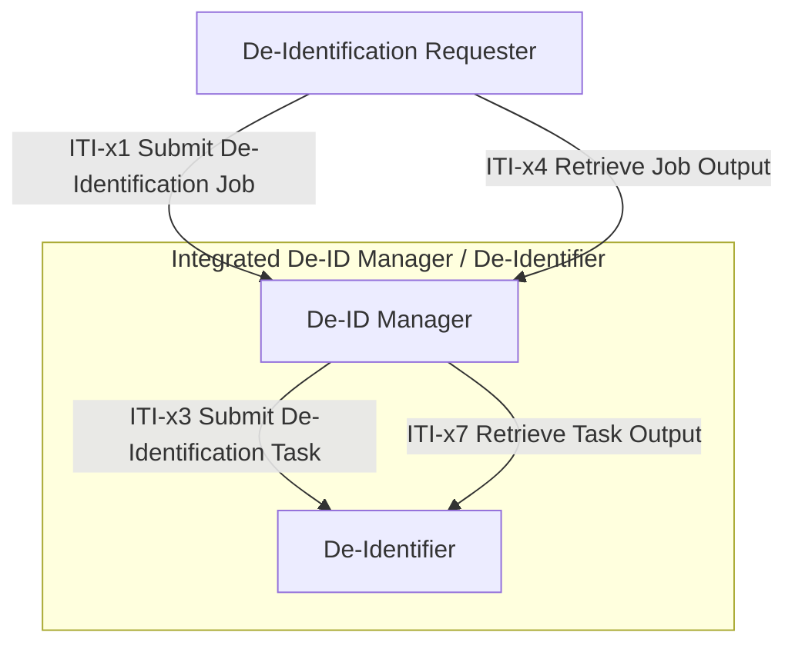
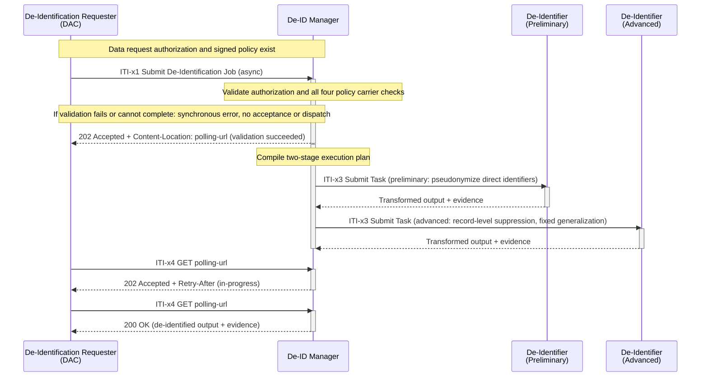
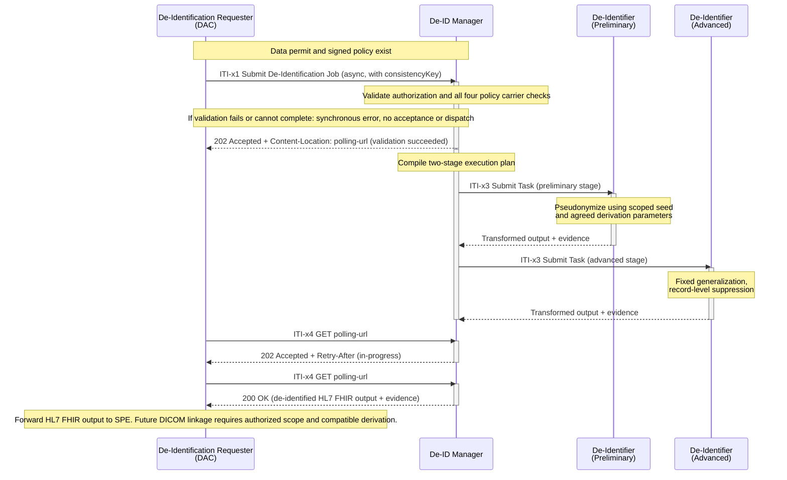
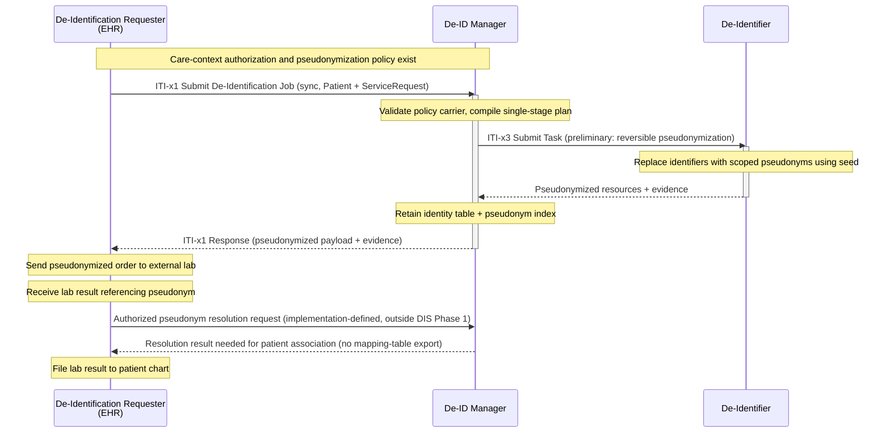
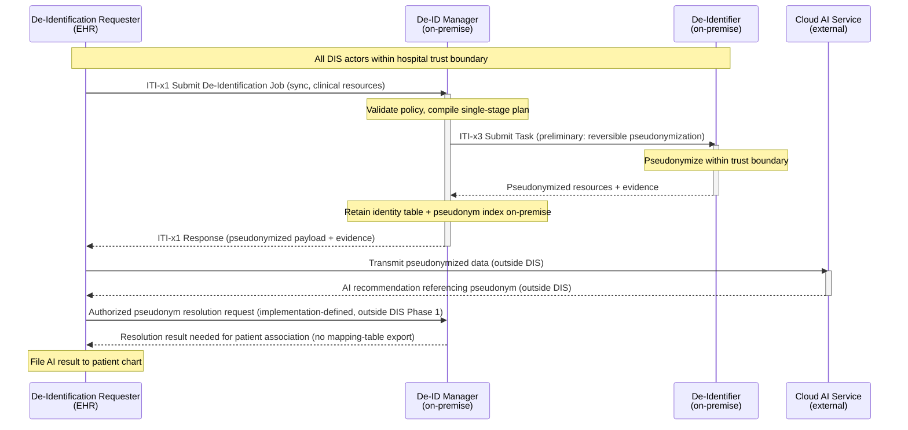
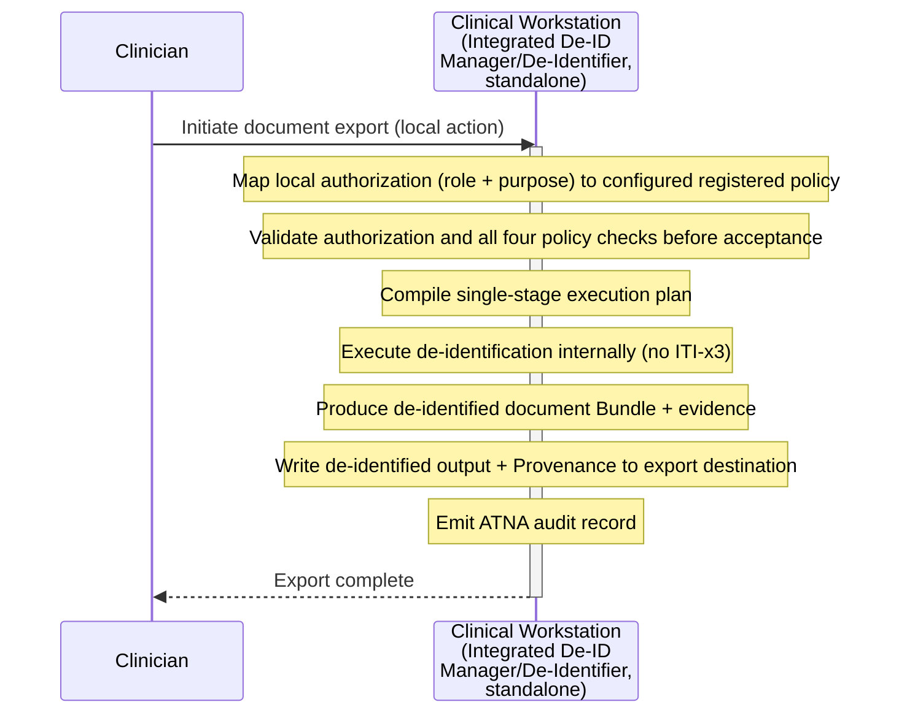

The De-Identification Services (DIS) Profile defines a standardized, policy-governed workflow for de-identification of HL7 FHIR health data. DIS enables authorized requesters to submit de-identification jobs referencing signed policy carriers and data request authorizations, and to receive de-identified output with auditable provenance evidence. The profile supports both synchronous single-patient workflows (such as clinical pseudonymization before external lab ordering or cloud AI invocation) and asynchronous multi-patient cohort workflows (such as cross-border research studies or AI/ML training dataset preparation).

DIS is a **Workflow** profile. It defines four actors, four transactions, a baseline policy execution model, an execution plan format, and a minimum evidence baseline. DIS begins after data request authorization has been established and a de-identification policy has been authorized. It does not standardize how a data permit or data-request approval is requested, approved, issued, discovered, amended, revoked, or retired.

DIS separates the mandatory HL7 FHIR R4 protocol binding from the processing payload binding. The protocol binding uses HL7 FHIR R4 APIs and resources exclusively for job submission, task dispatch, and status reporting; it is content-neutral and can orchestrate any payload type for which a corresponding payload binding is declared. DIS-FHIR-Payload is the HL7 FHIR payload binding, supporting independently versioned HL7 FHIR R4, R5, and R6 processing payloads; support for R5 or R6 payloads does not require an R5 or R6 version of the DIS protocol binding. Additional payload bindings (e.g., DIS-DICOM1, DIS-CDA1) may be defined independently to support non-FHIR data formats within the same HL7 FHIR R4 protocol layer.

The processing payload's format and version SHALL be explicitly identified. De-Identifiers SHALL declare supported payload bindings and versions, and the Manager SHALL verify compatibility before dispatch. HL7 FHIR payloads SHALL be validated against their declared version.

An HL7 FHIR payload using a different version from the R4 protocol binding SHALL be referenced or carried as explicitly identified serialized content using the payload binding's packaging rules; it SHALL NOT be embedded as a native resource of the other version in the R4 transaction envelope. Non-HL7 FHIR payloads (e.g., DICOM, CDA) SHALL be carried or referenced using their respective payload binding's packaging rules. Detailed version identification and packaging rules are specified in each payload binding.

## 1:PXX.1 DIS Actors, Transactions, and Content Modules

This section defines the actors, transactions, and content modules in the DIS Profile.

DIS defines three deployment models for de-identification processing:

- **Distributed model** -- the De-Identification Requester submits jobs to a De-ID Manager, which validates the policy carrier, compiles an execution plan, and dispatches tasks to one or more De-Identifiers. This model supports multi-stage execution with trust isolation between stages.
- **Integrated model with external Requester** -- the Integrated De-ID Manager/De-Identifier accepts jobs via ITI-x1, combines policy validation, execution plan compilation, and transformation execution within a single actor, and returns output to the Requester. ITI-x3 and ITI-x7 are internal.
- **Integrated standalone model** -- the Integrated De-ID Manager/De-Identifier operates without external transactions, producing conformant de-identified output and evidence through local invocation. This model supports lightweight workflows such as clinician-initiated document export (see [Use Case 5](#1pxx425-use-case-5-local-authorized-clinical-document-export)).

Figure 1:PXX.1-1 shows the actors directly involved in the DIS Profile and the relevant transactions between them. The dashed boundary represents the Integrated De-ID Manager/De-Identifier, which combines the De-ID Manager and De-Identifier into a single actor. When the Integrated actor is deployed, ITI-x3 and ITI-x7 are performed internally and do not appear on the wire.

**Figure 1:PXX.1-1: DIS Actor Diagram**

Table 1:PXX.1-1 lists the transactions for each actor directly involved in the DIS Profile. To claim compliance with this profile, an actor SHALL support all required transactions (labeled "R") and MAY support the optional transactions. Transactions labeled "C" (Conditional) are required when the corresponding option is declared.

<strong>Table 1:PXX.1-1: DIS Profile - Actors and Transactions</strong>

| Actors | Transactions | Initiator or Responder | Optionality | Reference |
|--------|-------------|------------------------|-------------|-----------|
| De-Identification Requester | ITI-x1 Submit De-Identification Job | Initiator | R | ITI TF-2: 3.x1 |
|  | ITI-x4 Retrieve Job Output | Initiator | C (See Note 1) | ITI TF-2: 3.x4 |
| De-ID Manager | ITI-x1 Submit De-Identification Job | Responder | R | ITI TF-2: 3.x1 |
|  | ITI-x3 Submit De-Identification Task | Initiator | R | ITI TF-2: 3.x3 |
|  | ITI-x4 Retrieve Job Output | Responder | C (See Note 1) | ITI TF-2: 3.x4 |
|  | ITI-x7 Retrieve Task Output | Initiator | C (See Note 1) | ITI TF-2: 3.x7 |
| De-Identifier | ITI-x3 Submit De-Identification Task | Responder | R | ITI TF-2: 3.x3 |
|  | ITI-x7 Retrieve Task Output | Responder | C (See Note 1) | ITI TF-2: 3.x7 |
| Integrated De-ID Manager/De-Identifier | ITI-x1 Submit De-Identification Job | Responder | O (See Note 2) | ITI TF-2: 3.x1 |
|  | ITI-x4 Retrieve Job Output | Responder | C (See Note 1, Note 2) | ITI TF-2: 3.x4 |
{: .grid}

Note 1: *ITI-x4 is required when the Asynchronous Job Processing Option (DIS-ASYNC-JOB) is supported. ITI-x7 is required when the Asynchronous Task Processing Option (DIS-ASYNC-TASK) is supported. ITI-x4 enables the Requester to poll for job output; ITI-x7 enables the Manager to retrieve task output from the De-Identifier. ITI-x7 does not apply to the Integrated De-ID Manager/De-Identifier.*

Note 2: *The Integrated De-ID Manager/De-Identifier MAY operate standalone without external transactions (content conformance only). When ITI-x1 is supported, the Integrated actor accepts jobs from an external De-Identification Requester. ITI-x4 is required when both ITI-x1 and DIS-ASYNC-JOB are supported.*

Table 1:PXX.1-2 lists the content modules defined for each actor. Each content module specifies the payload-specific rules for addressing, transformation, evidence, and packaging within a particular data format family.

<strong>Table 1:PXX.1-2: DIS Profile - Actors and Content Modules</strong>

| Actors | Content Modules | Optionality | Reference |
|--------|----------------|-------------|-----------|
| De-Identification Requester | DIS-FHIR-Payload | R (See Note 1) | [3:5.9](volume-3.html#fhir-payload-content-module) |
| De-ID Manager | DIS-FHIR-Payload | R (See Note 1) | [3:5.9](volume-3.html#fhir-payload-content-module) |
| De-Identifier | DIS-FHIR-Payload | R (See Note 1) | [3:5.9](volume-3.html#fhir-payload-content-module) |
| Integrated De-ID Manager/De-Identifier | DIS-FHIR-Payload | R (See Note 1) | [3:5.9](volume-3.html#fhir-payload-content-module) |
{: .grid}

Note 1: *DIS-FHIR-Payload is the only payload binding available in Phase 1. It supports independently versioned HL7 FHIR R4, R5, and R6 processing payloads. Future content modules (e.g., DIS-DICOM1, DIS-CDA1) may be defined for additional data formats.*

### 1:PXX.1.1 Actors

The actors in this profile are described in more detail in the sections below.

#### 1:PXX.1.1.1 De-Identification Requester

The De-Identification Requester submits de-identification jobs to the De-ID Manager, presenting a data request authorization and a signed de-identification policy carrier. In the synchronous mode, the Requester receives de-identified output and evidence inline in the ITI-x1 response. In the asynchronous mode, the Requester retrieves output via ITI-x4 polling.

In Phase 1, the De-Identification Requester is grouped with the De-Identified Data Receiver role -- the Requester receives output directly. No separate push-delivery path is standardized.

Phase 1 does not standardize how the Requester obtains a signed de-identification policy carrier. The Requester presents the carrier in ITI-x1; the mechanism by which it was obtained is an implementation-defined concern. Implementers MAY use any mechanism that produces a valid signed policy carrier, including local configuration, administrative provisioning, bilateral agreement, or integration with an external policy management system.

#### 1:PXX.1.1.2 De-ID Manager

The De-ID Manager receives de-identification jobs via ITI-x1, validates the data request authorization and policy carrier, compiles the policy into an execution plan, dispatches tasks to De-Identifiers via ITI-x3, and returns de-identified output and provenance evidence to the Requester.

The De-ID Manager is the sole persistent custodian of identity mappings and reversibility records. See [1:PXX.4.1](#1pxx41-concepts) for the policy carrier model, four-point validation, and carrier variants. See [1:PXX.5.4](#1pxx54-reversibility-material-custody) for custody obligations.

#### 1:PXX.1.1.3 De-Identifier

The De-Identifier executes assigned de-identification tasks received via ITI-x3. It is stateless with respect to reversibility -- it receives scoped, purpose-specific seeds as required by the assigned rules, produces transformations and evidence, and retains no identity-linking material after task termination. The De-Identifier derives transformation values, such as pseudonyms or date-shift offsets, according to the execution plan and its declared capabilities. It reports pseudonyms needed for reversibility to the Manager but does not retain the seed-to-identity mapping. The Manager supplies policy, scope, and seed material; it is not required to compute pseudonyms or date-shift offsets.

A Phase 1 De-Identifier SHALL declare its capabilities, including supported payload families (at least `fhir` for DIS-FHIR-Payload), supported action families (`core`), and zero or more named execution plans it natively supports. The declaration SHALL also identify supported transformation parameter inputs and derivation methods. Acceptance of precomputed pseudonyms or date-shift offsets is not mandatory. The De-ID Manager SHALL verify compatibility with the De-Identifier's declared capabilities before dispatching tasks via ITI-x3 and SHALL NOT dispatch an incompatible task.

#### 1:PXX.1.1.4 Integrated De-ID Manager/De-Identifier

The Integrated De-ID Manager/De-Identifier combines the functionality of the De-ID Manager and the De-Identifier into a single actor. It does not initiate nor accept the Submit De-Identification Task [ITI-x3] transaction.

The Integrated De-ID Manager/De-Identifier validates de-identification policy carriers, compiles validated policy into execution plans, executes the plans internally, and produces de-identified output and provenance evidence. It performs all Manager obligations (policy validation, execution plan compilation, reversibility material custody) and all De-Identifier obligations (transformation execution, evidence production, capability declaration) within a single actor.

The Integrated De-ID Manager/De-Identifier MAY operate standalone without external transactions, producing conformant de-identified output and evidence through local invocation. When ITI-x1 is supported, the Integrated actor accepts jobs from an external De-Identification Requester and returns output inline (synchronous) or via ITI-x4 polling (when DIS-ASYNC-JOB is also supported).

The Integrated De-ID Manager/De-Identifier is the sole persistent custodian of identity mappings and reversibility records, consistent with the De-ID Manager's custody obligations. Seeds, identity tables, pseudonym indices, and other protected transformation material remain within the integrated actor's trust boundary.

A Phase 1 Integrated De-ID Manager/De-Identifier SHALL declare its capabilities using the same structure required of a standalone De-Identifier, including supported payload families (at least `fhir` for DIS-FHIR-Payload), supported action families (`core`), and zero or more named execution plans. Multi-stage execution is performed internally; the integrated actor compiles and executes each stage in sequence without externalizing the inter-stage dispatch.

### 1:PXX.1.2 Transaction Descriptions

The transactions in this profile are summarized in the sections below.

#### 1:PXX.1.2.1 Submit De-Identification Job [ITI-x1]

This transaction is used to submit a de-identification job with a data request authorization and signed policy carrier. The De-ID Manager validates the submission, orchestrates processing, and returns de-identified output and evidence. The transaction supports both synchronous and asynchronous response modes.

For more details see the detailed [transaction description](volume-2.html).

#### 1:PXX.1.2.2 Submit De-Identification Task [ITI-x3]

This transaction is used to dispatch a de-identification task from the De-ID Manager to a De-Identifier. Each task carries the execution rules for one stage. The De-Identifier applies the transformation rules and returns de-identified output and evidence.

For more details see the detailed [transaction description](volume-2.html).

#### 1:PXX.1.2.3 Retrieve Job Output [ITI-x4]

This transaction is used by the De-Identification Requester to retrieve the status and output of a previously submitted asynchronous job.

For more details see the detailed [transaction description](volume-2.html).

#### 1:PXX.1.2.4 Retrieve Task Output [ITI-x7]

This transaction is used by the De-ID Manager to retrieve the output of a completed asynchronous task from a De-Identifier. This transaction is required when the Asynchronous Task Processing Option (DIS-ASYNC-TASK) is supported. It does not apply to the Integrated De-ID Manager/De-Identifier.

For more details see the detailed [transaction description](volume-2.html).

## 1:PXX.2 DIS Actor Options

Options that may be selected for each actor in this profile are listed in Table 1:PXX.2-1 below. Dependencies between options when applicable are specified in notes. All DIS actors support the HL7 FHIR R4 protocol binding as the mandatory baseline — the protocol binding is not an option but a requirement of implementing the profile.

<strong>Table 1:PXX.2-1: DIS Profile - Actor Options</strong>

| Actor | Option Name | Reference |
|-------|-------------|-----------|
| De-Identification Requester | HL7 FHIR Payload (DIS-FHIR-Payload) (See Note 1) | [1:PXX.2.3](#1pxx23-hl7-fhir-payload-option) |
| De-Identification Requester | Asynchronous Job Processing (DIS-ASYNC-JOB) | [1:PXX.2.4](#1pxx24-asynchronous-job-processing-option) |
| De-ID Manager | HL7 FHIR Payload (DIS-FHIR-Payload) (See Note 1) | [1:PXX.2.3](#1pxx23-hl7-fhir-payload-option) |
| De-ID Manager | Asynchronous Job Processing (DIS-ASYNC-JOB) | [1:PXX.2.4](#1pxx24-asynchronous-job-processing-option) |
| De-ID Manager | Asynchronous Task Processing (DIS-ASYNC-TASK) | [1:PXX.2.5](#1pxx25-asynchronous-task-processing-option) |
| De-ID Manager | Irreversible De-Identification (DIS-IRREVERSIBLE) | [1:PXX.2.6](#1pxx26-irreversible-de-identification-option) |
| De-ID Manager | Reversible Pseudonymization (DIS-REVERSIBLE) | [1:PXX.2.2](#1pxx22-reversible-pseudonymization-option) |
| De-Identifier | HL7 FHIR Payload (DIS-FHIR-Payload) (See Note 1) | [1:PXX.2.3](#1pxx23-hl7-fhir-payload-option) |
| De-Identifier | Asynchronous Task Processing (DIS-ASYNC-TASK) | [1:PXX.2.5](#1pxx25-asynchronous-task-processing-option) |
| De-Identifier | Irreversible De-Identification (DIS-IRREVERSIBLE) | [1:PXX.2.6](#1pxx26-irreversible-de-identification-option) |
| De-Identifier | Reversible Pseudonymization (DIS-REVERSIBLE) | [1:PXX.2.2](#1pxx22-reversible-pseudonymization-option) |
| Integrated De-ID Manager/De-Identifier | HL7 FHIR Payload (DIS-FHIR-Payload) (See Note 1) | [1:PXX.2.3](#1pxx23-hl7-fhir-payload-option) |
| Integrated De-ID Manager/De-Identifier | Asynchronous Job Processing (DIS-ASYNC-JOB) | [1:PXX.2.4](#1pxx24-asynchronous-job-processing-option) |
| Integrated De-ID Manager/De-Identifier | Irreversible De-Identification (DIS-IRREVERSIBLE) | [1:PXX.2.6](#1pxx26-irreversible-de-identification-option) |
| Integrated De-ID Manager/De-Identifier | Reversible Pseudonymization (DIS-REVERSIBLE) | [1:PXX.2.2](#1pxx22-reversible-pseudonymization-option) |
{: .grid}

Note 1: *DIS-FHIR-Payload is required for all actors in Phase 1 since it is the only available payload binding. It is structured as an option to support future payload bindings for additional data formats (e.g., DIS-DICOM1, DIS-CDA1). Each payload binding is independent of the protocol binding version.*

Table 1:PXX.2-2 summarizes all Phase 1 options and their applicability per actor.

<strong>Table 1:PXX.2-2: DIS Profile - Option Matrix</strong>

| Option | Requester | Manager | De-Identifier | Integrated Manager/De-Identifier | Dependency / obligation |
|--------|-----------|---------|---------------|-----------------------------------|-------------------------|
| DIS-FHIR-Payload | Required (Note 1) | Required (Note 1) | Required (Note 1) | Required (Note 1) | HL7 FHIR payload binding — content model, baseline execution plan, and data-plane access for independently versioned HL7 FHIR R4, R5, and R6 processing payloads. |
| DIS-ASYNC-JOB | Optional | Optional | Not applicable | Optional | Asynchronous job processing. Both participating Requester and Manager (or Integrated actor) declare support; ITI-x4 required. For the Integrated actor, DIS-ASYNC-JOB requires ITI-x1. |
| DIS-ASYNC-TASK | Not applicable | Optional | Optional | Not applicable | Asynchronous task processing. Both participating Manager and De-Identifier declare support; ITI-x7 required. Not applicable to the Integrated actor. |
| DIS-IRREVERSIBLE | Not applicable | Optional | Optional | Optional | Baseline pseudonymization mode — no reversibility material is retained. At least one of DIS-IRREVERSIBLE or DIS-REVERSIBLE SHALL be declared. |
| DIS-REVERSIBLE | Not applicable | Optional | Optional | Optional | Both participating Manager and De-Identifier declare reversible pseudonymization support. The Integrated actor declares this as a single actor. At least one of DIS-IRREVERSIBLE or DIS-REVERSIBLE SHALL be declared. |
{: .grid}

### 1:PXX.2.1 Mandatory Baseline

All DIS actors implement the HL7 FHIR R4 protocol binding as a mandatory requirement of the profile. This includes synchronous job processing via ITI-x1, task dispatch via ITI-x3 (for the De-ID Manager and De-Identifier), and the associated HL7 FHIR R4 workflow resources (Parameters, Task, Provenance, OperationOutcome). The protocol binding is content-neutral — it can orchestrate de-identification of any payload type for which a corresponding payload binding is declared. The HL7 FHIR R4 protocol binding is not an option; it is a mandatory requirement of the profile.

### 1:PXX.2.2 Reversible Pseudonymization Option

The Reversible Pseudonymization Option (DIS-REVERSIBLE) enables the De-ID Manager to retain reversibility material (identity table and pseudonym index) so that future re-identification can be performed without re-processing previously de-identified data.

When this option is supported, the De-ID Manager SHALL:

- Retain the identity table (cryptographic seed to patient identity mapping) created during policy compilation
- Build a pseudonym index from de-identification evidence reported by the De-Identifier at job completion
- Protect identity tables and pseudonym indices within its trust boundary -- these records SHALL NOT be disclosed outside the Manager's trust boundary; seed sharing with authorized De-Identifiers follows §1:PXX.5.4

A De-Identifier supporting this option SHALL produce pseudonyms that are deterministically derivable from the cryptographic seed, enabling the De-ID Manager to build its reverse-mapping chain from evidence without requiring the De-Identifier to retain any identity-linking material.

UC-3 and UC-4 illustrate authorized, implementation-defined access to the Manager's mapping service for patient association. Such access returns only the resolution result needed by the EHR and does not export the identity table or pseudonym index. Phase 1 does not standardize this interaction or introduce a re-identification transaction.

### 1:PXX.2.3 HL7 FHIR Payload Option

The HL7 FHIR Payload Option (DIS-FHIR-Payload) defines the content model, baseline execution plan, and data-plane access for HL7 FHIR processing payloads. This includes FHIRPath addressing, resource traversal, narrative handling, Provenance-based evidence, and HL7 FHIR REST read/write or inline by-value data-plane access. DIS-FHIR-Payload covers independently versioned HL7 FHIR R4, R5, and R6 processing payloads. The processing payload's HL7 FHIR version is independent of the R4 protocol binding version.

DIS-FHIR-Payload is one of potentially several payload binding options. Each payload binding defines format-specific content models, addressing, execution plan structure, and data-plane access for a particular data format family. Future payload bindings (e.g., DIS-DICOM1 for DICOM, DIS-CDA1 for CDA) are developed independently and can be carried within the same HL7 FHIR R4 protocol layer. An actor MAY declare multiple payload bindings to support de-identification of different data formats.

In Phase 1, DIS-FHIR-Payload is required for all actors since it is the only available payload binding.

#### 1:PXX.2.3.1 Baseline Execution Plan

DIS-FHIR-Payload defines a baseline execution plan model for HL7 FHIR payloads: flat, ordered rule lists carried as HL7 FHIR Library resources. Phase 1 execution plans SHALL NOT require policy composition, condition evaluation, cross-element constraints, conflict resolution strategies, or selector specificity rules. The full Composable Execution Plan (DIS-EXE1), including these features, is deferred to a future phase.

Multi-stage processing remains supported in Phase 1. The De-ID Manager dispatches a separate execution plan for each stage through ITI-x3; each plan contains only the ordered rules assigned to that stage.

The execution plan model is payload-specific. Each payload binding defines its own execution plan structure appropriate to its data standard. The policy layer, not the execution plan, serves as the cross-payload abstraction for de-identification requirements.

#### 1:PXX.2.3.2 Cross-Version Payload Support

DIS-FHIR-Payload supports processing payloads whose HL7 FHIR version differs from the HL7 FHIR R4 protocol binding. An R5 or R6 resource can be de-identified through R4 protocol transactions without requiring an R5 or R6 version of the protocol binding. This cross-version support rests on four design properties:

- **Version identification** -- each processing payload explicitly identifies its HL7 FHIR version. De-Identifiers declare which payload versions they support, and the Manager verifies compatibility before dispatch.
- **Version-safe packaging** -- an HL7 FHIR payload whose version differs from the R4 protocol binding is carried or referenced using the payload binding's packaging rules. It SHALL NOT be embedded as a native resource of the payload version in the R4 transaction envelope. Packaging patterns are specified in the [DIS-FHIR-Payload content module](volume-3.html#fhir-payload-content-module).
- **Version-neutral addressing** -- FHIRPath expressions used by execution plans and semantic group mappings resolve consistently across HL7 FHIR R4, R5, and R6 for the resource types and elements governed by DIS transformation actions.
- **Evidence across versions** -- de-identification evidence is represented as R4 HL7 FHIR Provenance (protocol layer, not payload). The evidence model does not depend on the payload's HL7 FHIR version.

R4 protocol resources (`Parameters`, `Task`, `Provenance`, `OperationOutcome`, `Bundle` used for workflow packaging) remain R4 regardless of the payload version.

### 1:PXX.2.4 Asynchronous Job Processing Option

The Asynchronous Job Processing Option (DIS-ASYNC-JOB) enables the De-Identification Requester and De-ID Manager (or Integrated actor) to support asynchronous job-level workflows. The Requester submits an asynchronous ITI-x1 request and retrieves de-identified output and evidence via ITI-x4 polling.

Both the participating Requester and Manager (or Integrated actor) SHALL declare DIS-ASYNC-JOB and SHALL support ITI-x4 (Retrieve Job Output). The Integrated actor SHALL support ITI-x1 when declaring DIS-ASYNC-JOB. This option is required for multi-patient cohort workflows where processing time exceeds the request timeout. HTTP-level message semantics are specified in the ITI-x1 and ITI-x4 [transaction descriptions](volume-2.html).

### 1:PXX.2.5 Asynchronous Task Processing Option

The Asynchronous Task Processing Option (DIS-ASYNC-TASK) enables the De-ID Manager and De-Identifier to support asynchronous task-level workflows. When DIS-ASYNC-TASK is declared, the De-ID Manager dispatches tasks via ITI-x3 and retrieves output, evidence, and validation status via ITI-x7 (Retrieve Task Output) after task completion.

Both the participating De-ID Manager and De-Identifier SHALL declare DIS-ASYNC-TASK and SHALL support ITI-x7. This option does not apply to the Integrated De-ID Manager/De-Identifier.

DIS-ASYNC-JOB and DIS-ASYNC-TASK are independent. A Manager may support async jobs without async tasks (processing tasks synchronously), or async tasks without async jobs (returning results synchronously to the Requester while dispatching tasks asynchronously to De-Identifiers).

### 1:PXX.2.6 Irreversible De-Identification Option

The Irreversible De-Identification Option (DIS-IRREVERSIBLE) declares the baseline pseudonymization mode where no reversibility material is retained. When this option is declared, the De-ID Manager does not retain identity tables or pseudonym indices after job completion. De-identified output cannot be reversed to recover the original patient identities.

At least one of DIS-IRREVERSIBLE or DIS-REVERSIBLE SHALL be declared by the De-ID Manager, De-Identifier, and Integrated De-ID Manager/De-Identifier. An actor MAY declare both options to indicate it supports both modes, with the mode selected per job by the de-identification policy.

## 1:PXX.3 DIS Required Actor Groupings

An actor from this profile (Column 1) SHALL implement all of the required transactions and/or content modules in this profile ***in addition to*** ***<u>all</u>*** of the requirements for the grouped actor (Column 2). Table 1:PXX.3-1 lists the required actor groupings.

<strong>Table 1:PXX.3-1: DIS Profile - Required Actor Groupings</strong>

| DIS Actor | Actor to be grouped with | Reference | Content Bindings Reference |
|-----------|--------------------------|-----------|---------------------------|
| De-Identification Requester | ATNA / Secure Application | [ITI TF-1: 9](https://profiles.ihe.net/ITI/TF/Volume1/ch-9.html) | -- |
| De-ID Manager | ATNA / Secure Node or Secure Application | [ITI TF-1: 9](https://profiles.ihe.net/ITI/TF/Volume1/ch-9.html) | -- |
| De-ID Manager | IUA / Authorization Client or Resource Server | [ITI TF-1: 34](https://profiles.ihe.net/ITI/TF/Volume1/ch-34.html) | -- |
| De-Identifier | ATNA / Secure Node or Secure Application | [ITI TF-1: 9](https://profiles.ihe.net/ITI/TF/Volume1/ch-9.html) | -- |
| Integrated De-ID Manager/De-Identifier | ATNA / Secure Node or Secure Application | [ITI TF-1: 9](https://profiles.ihe.net/ITI/TF/Volume1/ch-9.html) | -- |
| Integrated De-ID Manager/De-Identifier | IUA / Authorization Client or Resource Server | [ITI TF-1: 34](https://profiles.ihe.net/ITI/TF/Volume1/ch-34.html) | -- |
{: .grid}

All DIS actors SHALL be grouped with ATNA Secure Node or Secure Application to ensure that all transactions are audit-logged and that communications are secured via TLS.

The De-ID Manager and the Integrated De-ID Manager/De-Identifier SHALL be grouped with IUA Authorization Client or Resource Server to ensure that system-to-system authorization is enforced for job submission (ITI-x1) and output retrieval (ITI-x4). Implementations SHOULD use SMART Backend Services for automated system-to-system workflows.

## 1:PXX.4 DIS Overview

This section shows how the transactions of the DIS Profile are combined to address the use cases.

### 1:PXX.4.1 Concepts

DIS introduces the following key concepts that provide necessary background for understanding the profile.

**Policy-Governed De-Identification.** DIS separates policy definition from policy execution. A Requester submits a carrier that governs what transformations are applied. The De-ID Manager validates the carrier and the De-Identifier executes the plan. Trust is anchored in the carrier's digital signature, not in the Requester's identity -- the Requester acts as a courier for the signed carrier.

The De-ID Manager performs four-point validation on all carriers:

1. **Signature validity** -- the carrier's digital signature is cryptographically valid and issued by a trusted authority
2. **Schema conformance** -- the carrier content conforms to the expected schema
3. **Currency** -- the carrier is not expired or revoked
4. **Authorization consistency** -- the carrier is consistent with the data request authorization (scope, purpose, and processing target are compatible)

Phase 1 supports four carrier variants in ITI-x1:

- **Inline policy** -- a signed, format-neutral policy artifact embedded directly in the request. The Manager compiles it into a payload-specific execution plan.
- **By-reference policy** -- a reference pointing to a signed, format-neutral policy artifact stored externally. The Manager retrieves, validates, and compiles it.
- **Registered policy identifier** -- a policy identifier and optional version, resolved by the Manager to a specific, signed, format-neutral policy artifact. The resolved artifact undergoes the same four validation checks and compilation as inline or by-reference policies. Resolution MAY use a local registry, administrative configuration, or an external source; Phase 1 does not standardize the provisioning or resolution mechanism.
- **Named execution plan** -- an identifier referencing a pre-compiled, format-specific execution plan defined by an existing data standard (e.g., DICOM PS 3.15 Basic Profile). The plan is already expressed in the terms of a specific data standard and does not require compilation. The Manager validates the carrier and verifies that the De-Identifier declares native support for the named plan and version before dispatch.

A registered policy is described in format-neutral language and can be reused across data formats and use cases. Before execution, the Manager compiles it into a payload-specific execution plan. A named execution plan is already executable for its target data standard. Both undergo the same four-point validation.

Resolution of registered policy identifiers, named execution plans, or by-reference carriers does not introduce a policy discovery or retrieval transaction into Phase 1.

**Staged Execution.** DIS supports multi-stage de-identification. A preliminary stage handles direct identifiers (pseudonymization, suppression). An advanced stage applies policy-specified record-level rules to quasi-identifiers, such as fixed generalization, suppression, or noise addition. The De-ID Manager dispatches one ITI-x3 task per stage. Each De-Identifier sees only its assigned stage, enforcing trust isolation between stages.

**Phase 1 Transformation Scope.** Phase 1 excludes dataset- or database-level de-identification actions, including small-cell handling, frequency-based rare-condition suppression, and generalization or other transformations requiring statistics computed across the cohort. Multi-patient cohort processing remains supported for applying record-level rules with policy-specified parameters. Multi-stage execution does not extend this action scope. Dataset-level statistical disclosure control is deferred to a future phase; completing a Phase 1 workflow does not establish that any separately required dataset-level disclosure criteria have been met.

**Bulk Data Input and Output.** Phase 1 supports both input and output for asynchronous cohort jobs using manifests referencing NDJSON files. The Requester supplies a manifest referencing prepared input files; obtaining those files through source-system export is outside DIS. The Manager returns a manifest referencing de-identified output files together with evidence references. Processing remains limited to the Phase 1 action scope described above.

Each processing payload SHALL explicitly identify its HL7 FHIR version (R4, R5, or R6), independently of the R4 protocol binding. Participating actors SHALL declare supported input/output formats and payload versions, and the Manager SHALL verify compatibility before dispatch. File retrieval SHALL require authorization. Recipient-facing manifests and files SHALL NOT contain seeds or other protected transformation material. A failed job SHALL NOT release a partial dataset; failures SHALL be reported through job status.

Exact manifest fields, file retrieval and expiry behavior, and evidence/error packaging are to be specified in the payload and transaction bindings. Adoption of Bulk Data file conventions does not by itself establish conformance to the full HL7 Bulk Data API.

**Reversibility Custody.** When reversible pseudonymization is enabled, the De-ID Manager retains the identity table and pseudonym index. The De-Identifier is stateless with respect to reversibility. Identity tables and pseudonym indices remain within the Manager's trust boundary. Scoped, purpose-specific seeds may be shared with authorized De-Identifiers in separate trust boundaries under the controls in §1:PXX.5.4.

**Consistency Scope and Transformation Material.** The `consistencyKey` identifies an authorized linkage scope, such as a research project. It is not secret seed material and SHALL NOT, by itself, enable derivation of pseudonyms or date shifts. The Manager SHALL enforce authorization to use or reuse the scope. The Manager manages the lifecycle of consistent patient- and purpose-scoped seeds; the De-Identifier derives and applies transformation values using compatible methods, versions, and policy parameters. The Manager is not required to calculate those transformation values.

A shared `consistencyKey` alone does not guarantee identical results. Consistency also depends on resolving the same patient, supplying consistent seed material, and using compatible derivation methods, versions, and parameters. Identity resolution assumptions, derivation compatibility, seed rotation, and collision handling require explicit contracts and conformance tests.

Date-shift reference dates and offsets are protected transformation parameters, not consistency keys. Deterministic derivation from purpose-specific seeds is preferred. Where a De-Identifier generates a parameter that SHALL be reused, an explicit capability contract SHALL define its protected return to the Manager, authorized retention, and reuse in subsequent tasks. Acceptance of precomputed parameters is not mandatory for all De-Identifiers. Seed handling follows §1:PXX.5.4.

**Evidence Baseline.** Every completed de-identification task produces provenance evidence containing at minimum nine elements: evidence identifier, outcome status, workflow reference, target identifier, policy-decision reference, stage category, reversibility state, validation status, and audit correlation identifier.

**Conformance Layers.** DIS defines two conformance layers:

- **Content conformance** -- de-identified output and provenance evidence conform to the declared content module (e.g., DIS-FHIR-Payload). Content conformance covers the full pipeline: policy validation, execution plan compilation, transformation execution, and evidence production. The Integrated De-ID Manager/De-Identifier is the actor for content conformance claims. It MAY operate standalone without external transactions, producing conformant output through local invocation.
- **Transaction conformance** -- actors participate in external DIS transactions (ITI-x1, ITI-x3, ITI-x4, ITI-x7). Transaction conformance applies when actors communicate over standardized interfaces. The distributed model (Requester, Manager, De-Identifier) requires transaction conformance. The Integrated actor adds transaction conformance when it supports ITI-x1 (and optionally ITI-x4).

Content conformance is the foundation. An Integrated actor operating standalone claims content conformance only. When the Integrated actor also supports ITI-x1, it claims both content and transaction conformance. In the distributed model, the De-ID Manager and De-Identifier each claim transaction conformance for their respective transactions; the Manager is responsible for ensuring that the combined output achieves content conformance.

**Payload Binding Framework (Informative).** DIS separates the mandatory HL7 FHIR R4 protocol binding from the payload binding so that additional data formats can be supported without changing the protocol layer. The protocol binding defines how transactions are initiated, dispatched, and polled -- it is content-neutral and carries or references payloads of any format. Each payload binding defines the format-specific rules for a particular data format family. Phase 1 defines DIS-FHIR-Payload as the initial payload binding; additional payload bindings are expected to follow the same architectural pattern.

A payload binding defines at minimum:

1. **Content model** -- how data elements within the format are identified and addressed (e.g., FHIRPath for HL7 FHIR resources, DICOM tag paths for DICOM objects, XPath or CDA document model paths for CDA documents)
2. **Transformation action mapping** -- how the DIS core transformation actions (suppression, masking, pseudonymization, generalization, etc.) are applied to the format's data structures and element types
3. **Data-plane access** -- how the processing payload is retrieved, carried, or referenced within the R4 protocol envelope (e.g., inline by-value, by-reference with authorized retrieval, or format-specific packaging such as DICOM Part 10 files or CDA XML documents)
4. **Evidence mapping** -- how de-identification evidence and provenance are represented for the format, mapping format-specific outcomes to the DIS evidence baseline
5. **Version identification** -- how the payload's format version is declared, validated, and matched against De-Identifier capabilities
6. **Packaging rules** -- how a payload in this format is carried within or referenced from the HL7 FHIR R4 transaction envelope without being embedded as a native HL7 FHIR resource

The following table illustrates how future payload bindings could extend DIS to additional data formats. These bindings are not defined in Phase 1 and are provided for informational purposes only.

<strong>Table 1:PXX.4-1: Illustrative Future Payload Bindings (Informational)</strong>

| Payload Binding | Data Format | Content Model | Example Processing Targets | Packaging Approach |
|-----------------|-------------|---------------|----------------------------|-------------------|
| DIS-FHIR-Payload (Phase 1) | HL7 FHIR R4, R5, R6 | FHIRPath addressing, resource traversal, narrative handling | Patient, Bundle, Bulk Data NDJSON | Inline HL7 FHIR resources or by-reference via HL7 FHIR REST / Bulk Data manifests |
| DIS-DICOM1 (future) | DICOM | DICOM tag paths, sequence item traversal, pixel data handling | DICOM Part 10 objects, studies, series | By-reference via DICOMweb WADO-RS or as DICOM Part 10 binary attachments |
| DIS-CDA1 (future) | HL7 CDA R2 | XPath / CDA document model, section and entry traversal, narrative block handling | CDA documents (Continuity of Care, Discharge Summary, etc.) | Inline XML or by-reference as document attachments |
| DIS-V2-1 (future) | HL7 v2.x | Segment/field/component paths (e.g., PID-5, OBX-5) | HL7 v2 messages (ADT, ORU, ORM, etc.) | By-reference or inline as ER7/XML-encoded messages |
{: .grid}

An actor declares which payload bindings it supports. The De-ID Manager verifies payload binding compatibility between the Requester's job and the De-Identifier's declared capabilities before dispatching tasks. A single job uses one payload binding; the Manager does not perform cross-format transformation. An actor MAY declare multiple payload bindings to support de-identification workflows across different data format families.

Each future payload binding is developed as a self-contained specification, independent of other payload bindings. A new payload binding does not require changes to the HL7 FHIR R4 protocol binding or to previously defined payload bindings. This independence enables parallel development by different IHE domains or working groups, and allows implementations to adopt additional payload support incrementally.

### 1:PXX.4.2 Use Cases

#### 1:PXX.4.2.1 Use Case 1: Cross-Border Epidemiological Study Using IPS+

A research consortium conducts a cross-border epidemiological study combining population-based cancer-registry data with selected clinical information originally collected for healthcare delivery. The study examines incidence, treatment patterns, comorbidities, outcomes, and survival across participating jurisdictions.

##### 1:PXX.4.2.1.1 Cross-Border Epidemiological Study Use Case Description

Clinical data remain under primary-use governance when recorded or exchanged for care. Their reuse begins only after a secondary-use request has been assessed and an authorization context has been issued. The Data Access Coordinator (DAC) coordinates participating jurisdictions, resolves authorized source-data provision, and -- acting as the De-Identification Requester -- submits a DIS job to produce a cohort dataset transformed by pseudonymization and policy-specified record-level rules for subsequent delivery to a Secure Processing Environment (SPE).

The DAC submits an asynchronous ITI-x1 job with a signed policy carrier and HL7 FHIR processing targets. The De-ID Manager validates the policy and compiles a two-stage execution plan.

The preliminary stage pseudonymizes direct identifiers with reversible, project-scoped pseudonyms within the authorized scope identified by `consistencyKey`, using consistent patient-scoped seeds and compatible derivation parameters to preserve longitudinal linkage. The advanced stage applies policy-specified record-level suppression and fixed quasi-identifier generalization. Small-cell handling and transformations requiring cohort statistics are outside Phase 1; any required dataset-level assessment or processing occurs outside this DIS workflow before release to the SPE.

The DAC retrieves the de-identified output and evidence via ITI-x4 polling and forwards it to the SPE.

##### 1:PXX.4.2.1.2 Cross-Border Epidemiological Study Process Flow

**Figure 1:PXX.4.2.1.2-1: Use Case 1 - Cross-Border Epidemiological Study Process Flow**

#### 1:PXX.4.2.2 Use Case 2: Multimodal AI/ML Method Development (HL7 FHIR Input-Preparation)

An AI/ML consortium develops or validates cancer models using multimodal data -- structured clinical information, radiology, digital pathology, laboratory data, genomics, annotations, and outcomes. DIS handles the HL7 FHIR input-preparation portion of the pipeline.

##### 1:PXX.4.2.2.1 AI/ML Method Development Use Case Description

The consortium holds a data permit identifying the approved cohort, modalities, linkage requirements, and de-identification stages. The DAC acts as the De-Identification Requester and submits an asynchronous job for the structured clinical data (EHR records, laboratory results, outcome labels, annotations).

The De-ID Manager compiles a two-stage execution plan. The preliminary stage pseudonymizes direct identifiers with reversible, project-scoped pseudonyms within the authorized scope identified by `consistencyKey`, using consistent patient-scoped seeds and compatible derivation parameters. Future DICOM processing could reuse that authorized scope for clinical/imaging linkage, provided identity resolution and derivation compatibility are also established; reusing the scope identifier alone is insufficient.

The advanced stage applies fixed quasi-identifier generalization and policy-specified record-level suppression to the HL7 FHIR payload. Any required dataset-level assessment or processing occurs outside this DIS workflow before release to the SPE. The DAC retrieves the de-identified HL7 FHIR output via ITI-x4 and delivers it to the SPE.

##### 1:PXX.4.2.2.2 AI/ML Method Development Process Flow

**Figure 1:PXX.4.2.2.2-1: Use Case 2 - AI/ML Method Development (HL7 FHIR Input-Preparation) Process Flow**

#### 1:PXX.4.2.3 Use Case 3: Clinical Pathology Order (Pseudonymous Care)

A hospital EHR pseudonymizes patient context before sending a laboratory order to an external pathology lab. The lab operates under a pseudonymous-care model and processes orders referencing only the pseudonym.

##### 1:PXX.4.2.3.1 Clinical Pathology Order Use Case Description

Institutional policy prohibits the external lab from seeing direct patient identifiers. The EHR acts as the De-Identification Requester and submits a synchronous ITI-x1 job with care-context authorization, a pseudonymization policy carrier, and Patient plus ServiceRequest resources.

The De-ID Manager validates the policy and compiles a single-stage execution plan. The De-Identifier replaces patient identifiers with scoped pseudonyms -- the same pseudonym is used for the same patient within the project scope, enabling longitudinal result correlation. The De-ID Manager returns the pseudonymized payload and evidence inline in the ITI-x1 response.

The De-ID Manager retains custody of the identity table and pseudonym index. To associate the returned lab result with the correct patient chart, the EHR uses an authorized, implementation-defined interaction with the Manager's mapping service. The EHR receives only the resolution result needed for this association; the identity table and pseudonym index are not exported. This interaction is outside the transactions standardized by DIS Phase 1.

##### 1:PXX.4.2.3.2 Clinical Pathology Order Process Flow

**Figure 1:PXX.4.2.3.2-1: Use Case 3 - Clinical Pathology Order Process Flow**

#### 1:PXX.4.2.4 Use Case 4: AI-Assisted Clinical Decision Support (Cloud Deployment)

A hospital EHR pseudonymizes patient data before transmitting to a cloud-hosted AI service for clinical decision support. The AI service operates outside the hospital trust boundary and receives only pseudonymized data.

##### 1:PXX.4.2.4.1 AI-Assisted Clinical Decision Support Use Case Description

A clinician triggers AI decision support for an active patient encounter. The EHR submits the patient's HL7 FHIR resources (Observations, Conditions, MedicationStatements, Encounters) to the on-premise De-ID Manager for reversible pseudonymization. The De-ID Manager and De-Identifier operate entirely within the hospital trust boundary.

The De-ID Manager returns the pseudonymized payload synchronously. The EHR transmits pseudonymized data to the cloud AI service and receives recommendations referencing the pseudonym.

The EHR uses an authorized, implementation-defined interaction with the Manager's mapping service to associate the AI output with the correct patient chart. The Manager retains custody of the identity table and pseudonym index and returns only the resolution result needed for that association. This interaction is outside the transactions standardized by DIS Phase 1.

Protected security material (identity table, pseudonym index, cryptographic seeds) never leaves the hospital trust boundary.

##### 1:PXX.4.2.4.2 AI-Assisted Clinical Decision Support Process Flow

**Figure 1:PXX.4.2.4.2-1: Use Case 4 - AI-Assisted Clinical Decision Support Process Flow**

#### 1:PXX.4.2.5 Use Case 5: Local Authorized Clinical Document Export

An authorized clinician exports a de-identified HL7 FHIR document Bundle from a clinical workstation. Authorization derives from the clinician's local role and declared purpose -- no external data permit is required.

##### 1:PXX.4.2.5.1 Local Authorized Clinical Document Export Use Case Description

A clinician initiates export of a clinical document (for example, a discharge summary for patient-mediated sharing or a document for external referral). The clinical workstation hosts an Integrated De-ID Manager/De-Identifier operating standalone (without ITI-x1). The Integrated actor maps the local authorization to a configured registered de-identification policy. No external policy carrier acquisition is needed -- the policy is pre-configured by institutional administration.

The Integrated De-ID Manager/De-Identifier performs policy validation, compiles the execution plan, executes identifier handling per the configured policy, and produces the de-identified document Bundle with evidence -- all within a single actor. It writes the de-identified output and Provenance evidence to the export destination. An ATNA audit record is emitted recording the policy identifier, stage, outcome, and audit correlation.

This use case demonstrates that DIS supports lightweight local workflows without requiring heavy external permit infrastructure, using the Integrated De-ID Manager/De-Identifier in standalone mode without external transactions.

##### 1:PXX.4.2.5.2 Local Authorized Clinical Document Export Process Flow

**Figure 1:PXX.4.2.5.2-1: Use Case 5 - Local Authorized Clinical Document Export Process Flow**

## 1:PXX.5 DIS Security Considerations

See ITI TF-2: [Appendix Z.8 "Mobile Security Considerations"](https://profiles.ihe.net/ITI/TF/Volume2/ch-Z.html#z.8-mobile-security-considerations).

DIS processes health data that is identifiable at input and de-identified at output. The security architecture addresses threats arising during the transformation workflow.

### 1:PXX.5.1 Actor Grouping and Transport Security

All DIS actors SHALL be grouped with ATNA Secure Node or Secure Application ([ITI TF-1: 9](https://profiles.ihe.net/ITI/TF/Volume1/ch-9.html)). This grouping ensures that all DIS transactions are audit-logged and that communications are secured via mutual TLS. Implementations SHALL use TLS 1.2 or later for all DIS transactions.

### 1:PXX.5.2 Authorization

The De-ID Manager and the Integrated De-ID Manager/De-Identifier SHALL be grouped with IUA Authorization Client or Resource Server ([ITI TF-1: 34](https://profiles.ihe.net/ITI/TF/Volume1/ch-34.html)). System-to-system authorization for automated workflows SHOULD use SMART Backend Services with OAuth 2.0 client credentials grants. The De-ID Manager or Integrated De-ID Manager/De-Identifier SHALL verify that the Requester is authorized under the submitted data request authorization before accepting a job.

### 1:PXX.5.3 Policy Carrier Integrity

De-identification policy carriers are digitally signed. Trust is anchored in the policy carrier's signature, not in the Requester's identity -- the Requester acts as a courier. The De-ID Manager SHALL verify the signature, schema conformance, currency, and authorization consistency of every policy carrier before job execution. Policy carriers with invalid, expired, or untrusted signatures SHALL be rejected.

### 1:PXX.5.4 Reversibility Material Custody

The De-ID Manager is the sole persistent custodian of identity mappings and reversibility records (identity table and pseudonym index). These records SHALL NOT be disclosed outside the De-ID Manager's trust boundary.

Seeds SHALL contain no PII and SHALL NOT directly encode patient identity. Seeds remain protected transformation material because possession may enable linkage or reproduction of transformations. The Manager MAY transmit scoped, purpose-specific seeds to an authorized De-Identifier over a protected channel for the assigned task. The Manager and De-Identifier MAY operate in separate trust boundaries; deployment within a shared trust boundary is optional.

The De-Identifier SHALL use received seeds only for the assigned task and SHALL retain them only for the duration of task execution. It SHALL delete them when the task terminates, whether successfully or unsuccessfully, and SHALL retain no identity-linking material after termination. Seeds SHALL NOT be disclosed to data recipients or included in recipient-facing output, evidence, or logs.

Implementations deploying DIS-REVERSIBLE (Reversible Pseudonymization) SHALL implement access controls, encryption at rest, and audit logging for all reversibility material. The De-ID Manager SHALL enforce access controls preventing unauthorized access to reversibility material even by other DIS actors.

Date-shift reference dates, offsets, and other protected transformation parameters SHALL NOT be disclosed to data recipients or included in recipient-facing output, evidence, or logs. A De-Identifier SHALL retain them only for task execution and delete them at task termination. Any return to the Manager for authorized retention and reuse SHALL follow an explicit capability contract and use a protected channel. Such retention SHALL be consistent with the authorized policy and declared reversibility mode.

### 1:PXX.5.5 Trust Isolation Between Stages

When the De-ID Manager compiles a multi-stage execution plan, each De-Identifier receives only the execution rules for its assigned stage. A De-Identifier performing the advanced stage (quasi-identifier generalization, suppression) does not have access to the preliminary stage's pseudonym-to-identity mappings. This stage-scoped dispatch provides defense-in-depth: compromise of a single De-Identifier does not expose the complete identity-to-pseudonym chain.

The Integrated De-ID Manager/De-Identifier executes all stages within a single actor. Inter-stage trust isolation through separate De-Identifiers is not available in this deployment model. Implementations requiring defense-in-depth through stage-level trust boundaries SHALL use the separate De-ID Manager and De-Identifier actors.

### 1:PXX.5.6 Audit Logging

All DIS transactions SHALL generate ATNA audit events. Every completed de-identification task produces evidence containing an audit correlation identifier linking the de-identification event to the ATNA audit trail. Implementations SHOULD use IHE Basic Audit Log Patterns (BALP) for structured audit events.

## 1:PXX.6 DIS Cross-Profile Considerations

### IHE IUA - Internet User Authorization

The De-ID Manager and the Integrated De-ID Manager/De-Identifier group with IUA for system-to-system authorization. IUA Authorization Client is used when these actors need to obtain tokens; IUA Resource Server is used when they validate tokens presented by the De-Identification Requester. Implementations using SMART Backend Services for automated workflows operate through the IUA framework.

### IHE ATNA / BALP - Audit Trail and Node Authentication / Basic Audit Log Patterns

All DIS actors group with ATNA for transport security and audit logging. Implementations SHOULD use BALP for structured, HL7 FHIR-based audit event representation. The audit correlation identifier in DIS de-identification evidence links de-identification events to the broader ATNA audit trail, enabling end-to-end traceability from authorization through de-identification to output delivery.

### IHE MHD - Mobile Access to Health Documents

When de-identified output is delivered to a document sharing infrastructure, the De-Identification Requester (or a downstream consumer) MAY group with MHD Document Source to publish de-identified documents. MHD provides an HL7 FHIR-native document sharing transport that complements the DIS de-identification workflow.

### SMART on FHIR Backend Services

SMART Backend Services provides the OAuth 2.0 client credentials flow used for system-to-system authorization in automated DIS workflows. This is the recommended authorization pattern for server-to-server interactions where no end-user is present (for example, asynchronous cohort de-identification jobs submitted by a Data Access Coordinator).

### External Data Permit and Data Request Profiles

DIS consumes data request authorizations but does not produce them. The data request authorization presented in ITI-x1 is obtained through mechanisms outside DIS -- including national EHDS infrastructure, institutional governance workflows, bilateral agreements, or integration with external data permit services. DIS validates the authorization but is agnostic to its origin.
