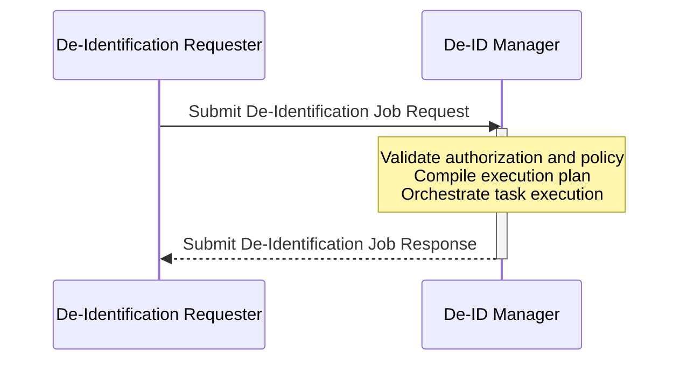
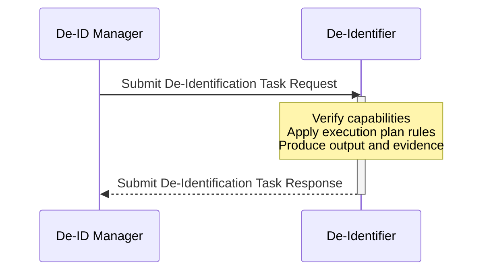
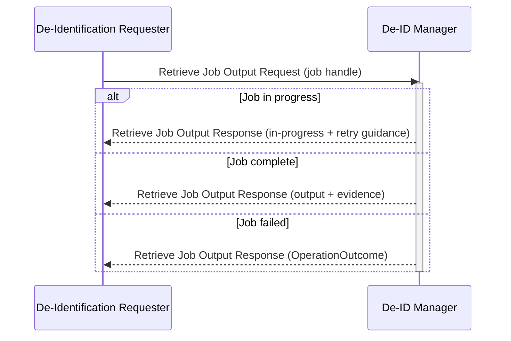
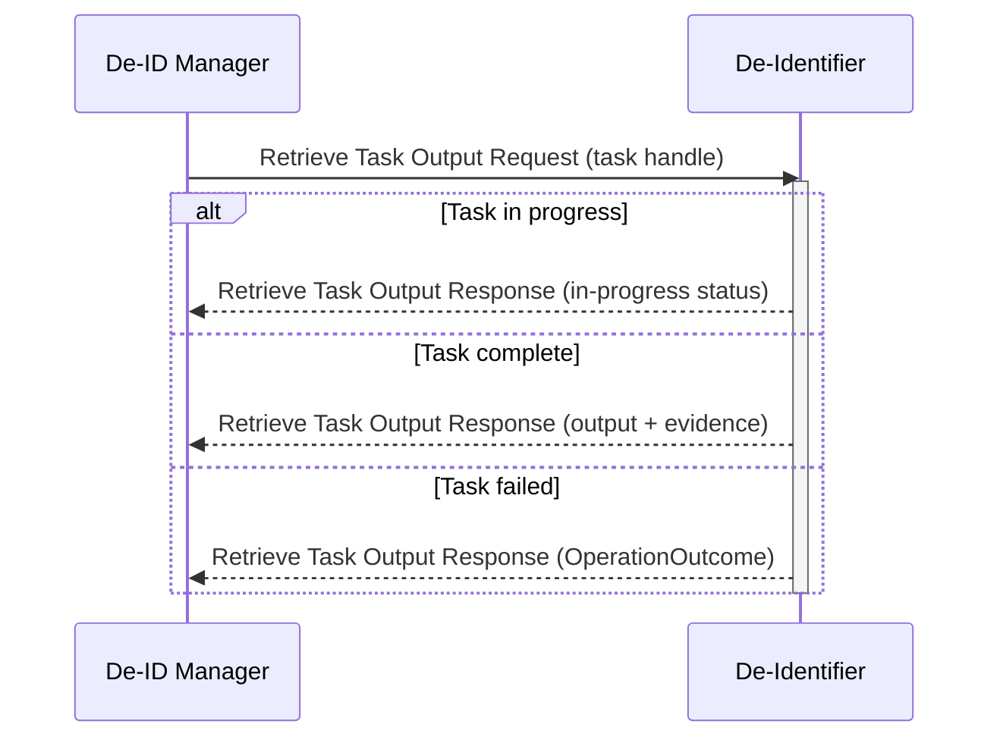

This volume contains the DIS Profile transaction specifications. Each section defines the scope, actor roles, interaction model, and expected actor behaviors for one transaction. Message semantics and CapabilityStatement definitions will be specified in subsequent drafts once the HL7 FHIR R4 resource profiles are finalized.

The following transactions are specified in this volume:

- [Submit De-Identification Job \[ITI-x1\]](#23x1-submit-de-identification-job-iti-x1)
- [Submit De-Identification Task \[ITI-x3\]](#23x3-submit-de-identification-task-iti-x3)
- [Retrieve Job Output \[ITI-x4\]](#23x4-retrieve-job-output-iti-x4)
- [Retrieve Task Output \[ITI-x7\]](#23x7-retrieve-task-output-iti-x7)

## 2:3.x1 Submit De-Identification Job [ITI-x1]

### 2:3.x1.1 Scope

The Submit De-Identification Job transaction is used by the De-Identification Requester to submit a de-identification job to the De-ID Manager (or Integrated De-ID Manager/De-Identifier). The submission declares the approved de-identification policy by canonical URL and version, presents evidence of the approved data request, and includes references to the processing targets. The Requester may optionally carry the JWS-signed policy content directly. The de-identification policy is a reusable knowledge artifact that may be approved for multiple independent data requests. The De-ID Manager validates the submission, verifies that the presented policy matches the policy approved in the data request authorization, compiles the policy into a payload-specific execution plan, orchestrates task execution via ITI-x3 (or executes internally for the Integrated actor), and returns de-identified output and provenance evidence. The transaction supports both synchronous and asynchronous response modes.

### 2:3.x1.2 Actors Roles

Table 2:3.x1.2-1 lists the actors and their roles in this transaction.

<strong>Table 2:3.x1.2-1: ITI-x1 Actor Roles</strong>

| Actor | Role |
|-------|------|
| [De-Identification Requester](volume-1.html#de-identification-requester) | Initiates the job submission, declaring the approved policy and presenting evidence of the approved data request, and receives de-identified output and evidence |
| [De-ID Manager](volume-1.html#de-id-manager) | Receives the job request, validates the authorization and policy, orchestrates execution, and returns de-identified output and evidence |
| [Integrated De-ID Manager/De-Identifier](volume-1.html#integrated-de-id-manager-de-identifier) | Acts as Responder in place of the De-ID Manager when ITI-x1 is supported (Optional for this actor) |
{: .grid}

### 2:3.x1.3 Referenced Standards

- [HL7 FHIR R4]({{site.data.fhir.path}}) — HL7 FHIR Release 4.0.1
- [HL7 FHIR R4 RESTful API]({{site.data.fhir.path}}http.html) — FHIR RESTful interactions
- [HL7 FHIR R4 Operations]({{site.data.fhir.path}}operations.html) — FHIR operation framework
- [HL7 FHIR R4 Asynchronous Request Pattern]({{site.data.fhir.path}}async.html) — async processing pattern (when DIS-ASYNC-JOB is supported)
- [HL7 FHIR R4 Parameters]({{site.data.fhir.path}}parameters.html) — input/output resource for operations
- [HL7 FHIR R4 OperationOutcome]({{site.data.fhir.path}}operationoutcome.html) — error reporting
- [HL7 FHIR R4 Provenance]({{site.data.fhir.path}}provenance.html) — de-identification evidence
- [RFC 7515](https://datatracker.ietf.org/doc/html/rfc7515) — JSON Web Signature (JWS), for `policy.content` signature validation
- [RFC 7517](https://datatracker.ietf.org/doc/html/rfc7517) — JSON Web Key (JWK), for signing key representation (applicable to `policy.content`)

### 2:3.x1.4 Messages

Figure 2:3.x1.4-1 shows the interaction for the Submit De-Identification Job transaction. The synchronous flow is shown. In asynchronous mode (DIS-ASYNC-JOB), the Manager returns a 202 Accepted response with a job handle; the Requester retrieves output and evidence using ITI-x4.

**Figure 2:3.x1.4-1: ITI-x1 Interaction Diagram**

#### 2:3.x1.4.1 Submit De-Identification Job Request Message

##### 2:3.x1.4.1.1 Trigger Events

The De-Identification Requester sends a Submit De-Identification Job Request when it requires de-identification of one or more processing targets under an approved data request. The Requester SHALL have obtained an approved data request authorization — which identifies the required de-identification policy — before initiating this transaction.

##### 2:3.x1.4.1.2 Message Semantics

The De-Identification Requester SHALL invoke the `$submit-dis-job` operation using `POST [base]/$submit-dis-job`. The request SHALL use `Content-Type: application/fhir+json`.

The request body SHALL be an HL7 FHIR R4 `Parameters` resource. Table 2:3.x1.4.1.2-1 lists the input parameters.

<strong>Table 2:3.x1.4.1.2-1: ITI-x1 Request Input Parameters</strong>

| Parameter | Cardinality | Type | Description |
|-----------|-------------|------|-------------|
| `authorization` | 1..1 | BackboneElement | Data request authorization evidence; exactly one variant SHALL be present |
| `authorization.reference` | 0..1 | Reference | Reference to an externally hosted authorization evidence resource |
| `authorization.content` | 0..1 | Attachment | Authorization evidence embedded directly; `contentType` declares the format |
| `policy` | 1..1 | BackboneElement | Identifies the approved de-identification policy for this data request |
| `policy.url` | 1..1 | uri | Canonical URL of the approved policy (`Library.url`) |
| `policy.version` | 1..1 | string | Version of the approved policy (`Library.version`) |
| `policy.content` | 0..1 | Binary | JWS-signed policy artifact, when the Requester carries the policy content directly. `Binary.contentType` SHALL be `application/jose`. |
| `processingTarget` | 1..* | Reference, uri, or Resource | Reference(s) to the resource(s) to be de-identified, or embedded resource content (see version-safe packaging below) |
| `payloadBinding` | 1..1 | code | Payload binding identifier (e.g., `DIS-FHIR-Payload`) |
| `payloadVersion` | 1..1 | code | HL7 FHIR version of the processing payload (e.g., `R4`, `R5`, `R6`) |
{: .grid}

Exactly one of `authorization.reference` or `authorization.content` SHALL be present. The authorization is evidence that a data governance authority approved a data request, including identification of the approved de-identification policy. DIS does not define the authorization's internal structure — it is determined by the authorization mechanism used in the deployment (e.g., EHDS data permit, institutional governance approval, bilateral agreement). The De-ID Manager is configured to understand the authorization format and extract the approved policy identity from it.

`policy.url` and `policy.version` are always required. They declare the canonical identity of the policy approved for this data request. The De-ID Manager validates these against the data request authorization (see authorization consistency below).

`policy.content` is optional. When present, the Requester carries the JWS-signed policy Library directly in the request, and the Manager SHALL verify the JWS signature and confirm that `Library.url` and `Library.version` inside the JWS payload match the declared `policy.url` and `policy.version`. When `policy.content` is absent, the Manager resolves the policy from the declared `policy.url` through its own mechanisms (local policy store, external fetch, etc.).

The `reversibilityMode` and `consistencyKey` are carried inside the policy artifact (see [§3:5.10.2](volume-3.html#35102-policy-rules-json-structure)) and are not duplicated as transaction parameters. The De-ID Manager extracts these values from the validated policy content. A de-identification policy is a reusable knowledge artifact: the same policy may be approved for and referenced by multiple independent data requests.

`processingTarget` supports three delivery modes: by-reference (a Reference to a resource on a source server), by-value (resource content embedded directly in the request), and by-manifest (a URI referencing an NDJSON manifest for bulk data cohort jobs). By-value delivery is typical for synchronous single-patient workflows where the data volume is small. By-reference delivery is typical when the source data resides on an existing HL7 FHIR server. For bulk data cohort jobs, `processingTarget` SHALL reference an NDJSON manifest URI.

When `payloadVersion` is HL7 FHIR R4, by-value `processingTarget` resources MAY be carried as native HL7 FHIR R4 resources within the `Parameters` envelope. When `payloadVersion` differs from the HL7 FHIR R4 protocol binding (i.e., R5 or R6), by-value resources SHALL NOT be embedded as native resources in the HL7 FHIR R4 transaction envelope. Instead, the content SHALL be packaged according to the version-safe packaging rules defined by the applicable payload binding (see [DIS-FHIR-Payload content module](volume-3.html#fhir-payload-content-module)). By-reference and by-manifest delivery modes are version-neutral — the payload version SHALL be declared at submission and verified against the retrieved content before processing.

When the Asynchronous Job Processing Option (DIS-ASYNC-JOB) is supported, the Requester SHALL include the `Prefer: respond-async` request header per the HL7 FHIR R4 Asynchronous Request Pattern.

**Editorial Note:** The parameter names and types shown in Table 2:3.x1.4.1.2-1 are illustrative. The formal OperationDefinition and StructureDefinition resources will be provided when FSH conformance artifacts are finalized.

##### 2:3.x1.4.1.3 Expected Actions

Upon receipt of a Submit De-Identification Job Request, the De-ID Manager (or Integrated De-ID Manager/De-Identifier) SHALL perform the following actions.

The Manager SHALL obtain and validate the data request authorization. When `authorization.reference` is present, the Manager resolves the referenced resource. When `authorization.content` is present, the Manager processes the embedded attachment according to the declared `contentType`. The authorization is evidence that a data governance authority approved a data request that specifies the data scope, purpose, and the de-identification policy to be applied. If the authorization is absent, expired, or does not cover the requested processing targets, the Manager SHALL reject the job with an OperationOutcome.

The Manager SHALL verify that the declared `policy.url` and `policy.version` identify the policy approved in the data request authorization. The mechanism for extracting the approved policy identity from the authorization is implementation-defined (it depends on the authorization format used in the deployment). A mismatch indicates the Requester is presenting a policy that was not approved for this data request; the Manager SHALL reject the job with an OperationOutcome.

The Manager SHALL obtain the policy content. When `policy.content` is present, the Manager SHALL verify the JWS signature against the trusted policy authority's public key and SHALL confirm that `Library.url` and `Library.version` inside the JWS payload match the declared `policy.url` and `policy.version`. When `policy.content` is absent, the Manager SHALL resolve the policy from the declared `policy.url` through its own mechanisms (see [§3:5.10.3](volume-3.html#35103-policy-delivery-and-validation)).

The Manager SHALL perform three-point policy content validation:

1. **Schema** — verify that the policy conforms to the applicable policy schema.
2. **Currency** — verify that the policy has not expired or been revoked.
3. **Integrity** — when `policy.content` is present, the JWS signature verification above fulfills this point. When `policy.content` is absent, integrity is established by the Manager's resolution trust model.

If any point of the four-point validation fails, the Manager SHALL reject the job with an OperationOutcome describing the failure point.

The Manager SHALL verify that each processing target reference in the request is resolvable and that the data request authorization covers the target. If a target is not resolvable or not covered, the Manager SHALL reject the job with an OperationOutcome.

When the policy is authored at the Semantic-Level (using semantic group references), the Manager SHALL compile the validated policy into a payload-specific execution plan for the applicable payload binding before dispatching tasks. When the policy is authored at the Syntax-Level (using concrete element paths for a specific payload family), the Manager SHALL validate that all rule targets are valid paths for the declared payload family and version, then package the rules as an execution plan for dispatch.

The Manager SHALL dispatch de-identification tasks to one or more De-Identifiers via ITI-x3, or execute the plan internally if it is an Integrated De-ID Manager/De-Identifier. The Manager SHALL NOT dispatch a task to a De-Identifier whose declared capabilities are incompatible with the task's payload binding or required transformation actions.

In synchronous mode, the Manager SHALL return de-identified output and provenance evidence in the response upon completion of all tasks.

In asynchronous mode (DIS-ASYNC-JOB), the Manager SHALL return a job handle in the response. The Requester retrieves output and evidence using ITI-x4.

#### 2:3.x1.4.2 Submit De-Identification Job Response Message

##### 2:3.x1.4.2.1 Trigger Events

The De-ID Manager sends a Submit De-Identification Job Response upon completion of job execution and output assembly. In asynchronous mode, the Manager sends the response immediately after accepting the job, before execution completes.

##### 2:3.x1.4.2.2 Message Semantics

The De-ID Manager (or Integrated De-ID Manager/De-Identifier) returns one of the HTTP status codes described below.

**200 OK — Synchronous success.** The response body is an HL7 FHIR R4 `Parameters` resource. Table 2:3.x1.4.2.2-1 lists the output parameters.

<strong>Table 2:3.x1.4.2.2-1: ITI-x1 Response Output Parameters (200 OK)</strong>

| Parameter | Cardinality | Type | Description |
|-----------|-------------|------|-------------|
| `output` | 1..1 | Resource or Bundle | De-identified resource(s) produced by the job |
| `evidence` | 1..* | Provenance | HL7 FHIR R4 Provenance resources recording transformation decisions |
| `validationStatus` | 1..1 | code | Overall validation outcome for the job |
{: .grid}

**202 Accepted — Asynchronous accepted (DIS-ASYNC-JOB).** The response body is empty. The `Content-Location` response header contains the polling URL for use with ITI-x4.

**400 Bad Request.** The response body is an HL7 FHIR R4 `OperationOutcome` describing the malformed request.

**401 Unauthorized / 403 Forbidden.** The response body is an HL7 FHIR R4 `OperationOutcome` describing the authorization failure.

**422 Unprocessable Entity.** The response body is an HL7 FHIR R4 `OperationOutcome` identifying which of the four policy validation points (authorization consistency, integrity, schema conformance, currency) failed.

**500 Internal Server Error.** The response body is an HL7 FHIR R4 `OperationOutcome` describing the server error.

**Editorial Note:** The parameter names and types shown in Table 2:3.x1.4.2.2-1 are illustrative. The formal OperationDefinition and StructureDefinition resources will be provided when FSH conformance artifacts are finalized.

##### 2:3.x1.4.2.3 Expected Actions

Upon receipt of a Submit De-Identification Job Response, the De-Identification Requester SHALL inspect the response status.

In synchronous mode, on a successful response, the Requester SHALL accept and process the de-identified output and provenance evidence returned in the response. On an error response, the Requester SHALL inspect the OperationOutcome and SHALL NOT treat the failed response as valid de-identified output.

In asynchronous mode (DIS-ASYNC-JOB), on a 202 Accepted response, the Requester SHALL retain the job handle and SHALL proceed to poll for output using ITI-x4.

#### 2:3.x1.4.3 CapabilityStatement Resource

The De-ID Manager and Integrated De-ID Manager/De-Identifier implementing this transaction SHALL provide a CapabilityStatement Resource as described in [ITI TF-2: Appendix Z.3](https://profiles.ihe.net/ITI/TF/Volume2/ch-Z.html#z.3-capabilitystatement-resource) indicating that the `$submit-dis-job` operation is implemented.

The De-Identification Requester implementing this transaction SHALL provide a CapabilityStatement Resource indicating that it can invoke the `$submit-dis-job` operation.

### 2:3.x1.5 Security Considerations

See [DIS Security Considerations](volume-1.html#security-considerations).

#### 2:3.x1.5.1 Security Audit Considerations

The De-Identification Requester and the De-ID Manager (or Integrated De-ID Manager/De-Identifier) SHALL record an audit event for each ITI-x1 transaction. The audit event SHALL identify the Requester, the Manager, the policy identifier, the processing target(s), and the job outcome (success, rejection, or failure). Implementations SHOULD use [IHE Basic Audit Log Patterns (BALP)](https://profiles.ihe.net/ITI/BALP/) for structured audit event representation. The audit correlation identifier produced in the de-identification evidence SHALL be included in the audit event to enable end-to-end traceability.

## 2:3.x3 Submit De-Identification Task [ITI-x3]

### 2:3.x3.1 Scope

The Submit De-Identification Task transaction is used by the De-ID Manager to dispatch a de-identification task for one ruleSet to a De-Identifier. Each task conveys the compiled execution plan rules for one ruleSet, a reference to the processing target, and any scoped seed material required for the assigned transformations. The De-Identifier verifies capability compatibility, applies the execution plan rules to the processing target, produces de-identified output conforming to the declared payload binding and version, and returns the output with provenance evidence. The transaction supports both synchronous and asynchronous response modes. This transaction does not apply to the Integrated De-ID Manager/De-Identifier.

### 2:3.x3.2 Actors Roles

Table 2:3.x3.2-1 lists the actors and their roles in this transaction.

<strong>Table 2:3.x3.2-1: ITI-x3 Actor Roles</strong>

| Actor | Role |
|-------|------|
| [De-ID Manager](volume-1.html#de-id-manager) | Initiates the task dispatch, providing compiled execution plan rules, a processing target reference, and scoped seed material |
| [De-Identifier](volume-1.html#de-identifier) | Receives the task, verifies capability compatibility, applies the execution plan rules to the processing target, and returns de-identified output and evidence |
{: .grid}

### 2:3.x3.3 Referenced Standards

- [HL7 FHIR R4]({{site.data.fhir.path}}) — HL7 FHIR Release 4.0.1
- [HL7 FHIR R4 RESTful API]({{site.data.fhir.path}}http.html) — FHIR RESTful interactions
- [HL7 FHIR R4 Operations]({{site.data.fhir.path}}operations.html) — FHIR operation framework
- [HL7 FHIR R4 Task]({{site.data.fhir.path}}task.html) — task resource for workflow dispatch
- [HL7 FHIR R4 Library]({{site.data.fhir.path}}library.html) — execution plan carrier
- [HL7 FHIR R4 Provenance]({{site.data.fhir.path}}provenance.html) — de-identification evidence
- [HL7 FHIR R4 OperationOutcome]({{site.data.fhir.path}}operationoutcome.html) — error reporting

### 2:3.x3.4 Messages

Figure 2:3.x3.4-1 shows the interaction for the Submit De-Identification Task transaction. The synchronous flow is shown. In asynchronous mode (DIS-ASYNC-TASK), the De-Identifier returns a 202 Accepted response with a task handle; the Manager retrieves output and evidence using ITI-x7.

**Figure 2:3.x3.4-1: ITI-x3 Interaction Diagram**

#### 2:3.x3.4.1 Submit De-Identification Task Request Message

##### 2:3.x3.4.1.1 Trigger Events

The De-ID Manager sends a Submit De-Identification Task Request for each ruleSet after successfully validating the policy and compiling the execution plan. The Manager SHALL verify the De-Identifier's declared capabilities before dispatching the task and SHALL NOT dispatch a task whose payload binding or required transformation actions fall outside the De-Identifier's declared capabilities.

##### 2:3.x3.4.1.2 Message Semantics

The De-ID Manager SHALL invoke the `$submit-dis-task` operation using `POST [base]/$submit-dis-task`. The request SHALL use `Content-Type: application/fhir+json`.

The request body SHALL be an HL7 FHIR R4 `Parameters` resource. Table 2:3.x3.4.1.2-1 lists the input parameters.

<strong>Table 2:3.x3.4.1.2-1: ITI-x3 Request Input Parameters</strong>

| Parameter | Cardinality | Type | Description |
|-----------|-------------|------|-------------|
| `executionPlan` | 1..1 | Reference(Library) | Reference to the Library resource containing the compiled execution plan rules for this ruleSet; rules are carried in `Library.content` |
| `processingTarget` | 1..* | Reference or uri | Reference(s) to the data to be transformed |
| `ruleSetId` | 1..1 | string | Identifier of the ruleSet from the source policy that this task executes |
| `stageId` | 0..1 | string | Stage identifier, when the source policy declares staged execution |
| `payloadBinding` | 1..1 | code | Payload binding identifier |
| `payloadVersion` | 1..1 | code | HL7 FHIR version of the processing payload |
| `seedMaterial` | 0..1 | Binary | Scoped, purpose-specific seed material for deterministic pseudonymization and date shifting |
| `reversibilityMode` | 1..1 | code | `irreversible` or `reversible`; derived from the `policy` validated in ITI-x1 |
{: .grid}

The `reversibilityMode` in ITI-x3 is derived from the `policy` validated in ITI-x1. The De-ID Manager passes the policy-determined mode to the De-Identifier as an operational instruction; the De-Identifier does not independently select the mode.

When `seedMaterial` is present, it is transmitted over the TLS-protected channel. The De-Identifier SHALL delete all seed material at task termination, regardless of whether the task succeeds or fails.

When the Asynchronous Task Processing Option (DIS-ASYNC-TASK) is supported, the Manager SHALL include the `Prefer: respond-async` request header per the HL7 FHIR R4 Asynchronous Request Pattern.

**Editorial Note:** The parameter names and types shown in Table 2:3.x3.4.1.2-1 are illustrative. The formal OperationDefinition and StructureDefinition resources will be provided when FSH conformance artifacts are finalized.

##### 2:3.x3.4.1.3 Expected Actions

Upon receipt of a Submit De-Identification Task Request, the De-Identifier SHALL perform the following actions.

The De-Identifier SHALL verify that the task's payload binding and version are within its declared capabilities. If the task specifies a payload binding or version that the De-Identifier does not support, the De-Identifier SHALL reject the task with an OperationOutcome.

The De-Identifier SHALL apply the execution plan rules to the processing target in full. Partial execution is not permitted. If any rule cannot be applied, the De-Identifier SHALL reject the task with an OperationOutcome and SHALL NOT produce partial output.

The De-Identifier SHALL produce de-identified output conforming to the declared payload binding and version.

The De-Identifier SHALL produce provenance evidence containing at minimum the nine baseline evidence elements defined by the applicable payload binding (e.g., DIS-FHIR-Payload). Evidence SHALL faithfully record the transformation decisions made during task execution.

The De-Identifier SHALL use received seed material only for the assigned task. The De-Identifier SHALL delete all seed material at task termination, regardless of whether the task succeeds or fails. The De-Identifier SHALL NOT retain any identity-linking material after task termination.

In synchronous mode, the De-Identifier SHALL return de-identified output and evidence in the response upon task completion.

In asynchronous mode (DIS-ASYNC-TASK), the De-Identifier SHALL return a task handle in the response. The Manager retrieves output and evidence using ITI-x7.

#### 2:3.x3.4.2 Submit De-Identification Task Response Message

##### 2:3.x3.4.2.1 Trigger Events

The De-Identifier sends a Submit De-Identification Task Response upon completion of task execution. In asynchronous mode, the De-Identifier sends the response immediately after accepting the task, before execution completes.

##### 2:3.x3.4.2.2 Message Semantics

The De-Identifier returns one of the HTTP status codes described below.

**200 OK — Synchronous success.** The response body is an HL7 FHIR R4 `Parameters` resource. Table 2:3.x3.4.2.2-1 lists the output parameters.

<strong>Table 2:3.x3.4.2.2-1: ITI-x3 Response Output Parameters (200 OK)</strong>

| Parameter | Cardinality | Type | Description |
|-----------|-------------|------|-------------|
| `output` | 1..1 | Resource or Bundle | De-identified resource(s) produced for this ruleSet |
| `evidence` | 1..* | Provenance | HL7 FHIR R4 Provenance resources recording transformation decisions for this task, including the nine baseline evidence elements |
| `validationStatus` | 1..1 | code | Per-task validation outcome |
{: .grid}

**202 Accepted — Asynchronous accepted (DIS-ASYNC-TASK).** The response body is empty. The `Content-Location` response header contains the polling URL for use with ITI-x7.

**422 Unprocessable Entity.** The response body is an HL7 FHIR R4 `OperationOutcome` indicating that the task's payload binding, payload version, or required transformation actions fall outside the De-Identifier's declared capabilities.

**500 Internal Server Error.** The response body is an HL7 FHIR R4 `OperationOutcome` describing the execution failure. No partial output is returned.

**Editorial Note:** The parameter names and types shown in Table 2:3.x3.4.2.2-1 are illustrative. The formal OperationDefinition and StructureDefinition resources will be provided when FSH conformance artifacts are finalized.

##### 2:3.x3.4.2.3 Expected Actions

Upon receipt of a Submit De-Identification Task Response, the De-ID Manager SHALL inspect the response status.

In synchronous mode, on a successful response, the Manager SHALL accept the de-identified output and evidence for assembly into the job response to the Requester. On an error response, the Manager SHALL inspect the OperationOutcome, SHALL NOT incorporate partial output into the job result, and SHALL report the failure to the Requester via the ITI-x1 response.

In asynchronous mode (DIS-ASYNC-TASK), on a 202 Accepted response, the Manager SHALL retain the task handle and SHALL proceed to retrieve output using ITI-x7.

#### 2:3.x3.4.3 CapabilityStatement Resource

The De-Identifier implementing this transaction SHALL provide a CapabilityStatement Resource as described in [ITI TF-2: Appendix Z.3](https://profiles.ihe.net/ITI/TF/Volume2/ch-Z.html#z.3-capabilitystatement-resource) indicating that the `$submit-dis-task` operation is implemented. The CapabilityStatement SHALL include the De-Identifier's declared capabilities: supported payload families, supported action families, and supported transformation parameter inputs.

The De-ID Manager implementing this transaction SHALL provide a CapabilityStatement Resource indicating that it can invoke the `$submit-dis-task` operation.

### 2:3.x3.5 Security Considerations

See [DIS Security Considerations](volume-1.html#security-considerations).

#### 2:3.x3.5.1 Security Audit Considerations

The De-ID Manager and the De-Identifier SHALL record an audit event for each ITI-x3 transaction. The audit event SHALL identify the Manager, the De-Identifier, the ruleSet identifier, the payload binding and version, and the task outcome. The stage identifier SHALL also be recorded when the source policy declares staged execution. The audit event SHALL NOT include seed material or other protected transformation parameters. Implementations SHOULD use [IHE BALP](https://profiles.ihe.net/ITI/BALP/) for structured audit event representation.

## 2:3.x4 Retrieve Job Output [ITI-x4]

### 2:3.x4.1 Scope

The Retrieve Job Output transaction is used by the De-Identification Requester to retrieve the status and output of a previously submitted asynchronous de-identification job. The Requester polls the De-ID Manager (or Integrated De-ID Manager/De-Identifier) using the job handle received in the ITI-x1 202 Accepted response. The Manager returns the current job status, and when the job is complete, returns the de-identified output and provenance evidence. This transaction is required when the Asynchronous Job Processing Option (DIS-ASYNC-JOB) is declared.

### 2:3.x4.2 Actors Roles

Table 2:3.x4.2-1 lists the actors and their roles in this transaction.

<strong>Table 2:3.x4.2-1: ITI-x4 Actor Roles</strong>

| Actor | Role |
|-------|------|
| [De-Identification Requester](volume-1.html#de-identification-requester) | Initiates the poll request, presenting the job handle received from ITI-x1 |
| [De-ID Manager](volume-1.html#de-id-manager) | Receives the poll request and returns job status, de-identified output, and evidence upon completion |
| [Integrated De-ID Manager/De-Identifier](volume-1.html#integrated-de-id-manager-de-identifier) | Acts as Responder in place of the De-ID Manager when ITI-x1 and DIS-ASYNC-JOB are both supported |
{: .grid}

### 2:3.x4.3 Referenced Standards

- [HL7 FHIR R4]({{site.data.fhir.path}}) — HL7 FHIR Release 4.0.1
- [HL7 FHIR R4 Asynchronous Request Pattern]({{site.data.fhir.path}}async.html) — async processing pattern
- [HL7 FHIR R4 OperationOutcome]({{site.data.fhir.path}}operationoutcome.html) — error reporting
- [HL7 Bulk Data Access IG](https://hl7.org/fhir/uv/bulkdata/) — bulk data manifest and NDJSON conventions (when processing cohort jobs)

### 2:3.x4.4 Messages

Figure 2:3.x4.4-1 shows the interaction for the Retrieve Job Output transaction, including the three possible response states.

**Figure 2:3.x4.4-1: ITI-x4 Interaction Diagram**

#### 2:3.x4.4.1 Retrieve Job Output Request Message

##### 2:3.x4.4.1.1 Trigger Events

The De-Identification Requester sends a Retrieve Job Output Request to poll the status of an asynchronous job. The Requester SHALL reference the job handle received in the ITI-x1 202 Accepted response. The Requester SHOULD respect any retry-after guidance returned in a prior polling response before sending a subsequent request.

##### 2:3.x4.4.1.2 Message Semantics

The De-Identification Requester SHALL poll using `GET [Content-Location]`, where `[Content-Location]` is the URL received in the `Content-Location` response header of the ITI-x1 `202 Accepted` response.

The request body is empty.

The Requester SHALL include authorization credentials consistent with those presented in the original ITI-x1 submission.

##### 2:3.x4.4.1.3 Expected Actions

Upon receipt of a Retrieve Job Output Request, the De-ID Manager (or Integrated De-ID Manager/De-Identifier) SHALL return the current status of the referenced job.

The Manager SHALL enforce authorization on retrieval. Only the original De-Identification Requester, or an explicitly authorized delegate, SHALL be permitted to retrieve the output of a given job. The Manager SHALL reject unauthorized retrieval requests with an appropriate error.

When the job is still in progress, the Manager SHALL indicate in-progress status and SHOULD include retry-after guidance to help the Requester pace its polling.

When the job is complete, the Manager SHALL return the de-identified output and provenance evidence. The Manager SHALL retain completed job output for a minimum retention period sufficient for the Requester to retrieve it; the specific duration is implementation-defined in Phase 1.

When the job has failed, the Manager SHALL return error information via OperationOutcome. The Manager SHALL NOT release partial output.

#### 2:3.x4.4.2 Retrieve Job Output Response Message

##### 2:3.x4.4.2.1 Trigger Events

The De-ID Manager sends a Retrieve Job Output Response upon receipt of each poll request. The response content depends on the current state of the referenced job at the time the request is processed.

##### 2:3.x4.4.2.2 Message Semantics

The De-ID Manager (or Integrated De-ID Manager/De-Identifier) returns one of three HTTP status codes per the HL7 FHIR R4 Asynchronous Request Pattern.

**202 Accepted — Job in progress.** The `Retry-After` response header contains the recommended polling interval in seconds. The `X-Progress` response header MAY be present with a human-readable status string. The response body is empty.

**200 OK — Job complete.** The response body is an HL7 FHIR R4 `Parameters` resource containing an `output` parameter (de-identified resources, or an NDJSON manifest for bulk data cohort jobs) and one or more `evidence` parameters (HL7 FHIR R4 `Provenance` resources). For bulk data cohort jobs, the manifest includes references to NDJSON output files and associated evidence.

**4xx/5xx — Error.** The response body is an HL7 FHIR R4 `OperationOutcome` describing the failure. No partial output is returned.

##### 2:3.x4.4.2.3 Expected Actions

Upon receipt of a Retrieve Job Output Response, the De-Identification Requester SHALL inspect the response status.

On an in-progress response, the Requester SHOULD wait for the indicated retry-after period before issuing another poll request.

On a complete response, the Requester SHALL accept and process the de-identified output and provenance evidence returned in the response.

On an error response, the Requester SHALL inspect the OperationOutcome and SHALL NOT treat the failed response as valid de-identified output.

#### 2:3.x4.4.3 CapabilityStatement Resource

The De-ID Manager and Integrated De-ID Manager/De-Identifier declaring DIS-ASYNC-JOB SHALL provide a CapabilityStatement Resource as described in [ITI TF-2: Appendix Z.3](https://profiles.ihe.net/ITI/TF/Volume2/ch-Z.html#z.3-capabilitystatement-resource) indicating support for the ITI-x4 polling interaction.

The De-Identification Requester declaring DIS-ASYNC-JOB SHALL provide a CapabilityStatement Resource indicating that it can perform the ITI-x4 polling interaction.

### 2:3.x4.5 Security Considerations

See [DIS Security Considerations](volume-1.html#security-considerations).

#### 2:3.x4.5.1 Security Audit Considerations

The De-Identification Requester and the De-ID Manager (or Integrated De-ID Manager/De-Identifier) SHALL record an audit event for each ITI-x4 poll that returns a completed job. Polling requests that return in-progress status SHOULD be logged but MAY be recorded at a reduced frequency to avoid audit log volume. The audit event for a completed retrieval SHALL include the job identifier and the audit correlation identifier from the de-identification evidence. Implementations SHOULD use [IHE BALP](https://profiles.ihe.net/ITI/BALP/) for structured audit event representation.

## 2:3.x7 Retrieve Task Output [ITI-x7]

### 2:3.x7.1 Scope

The Retrieve Task Output transaction is used by the De-ID Manager to retrieve the status and output of a previously dispatched asynchronous de-identification task from a De-Identifier. The Manager polls the De-Identifier using the task handle received in the ITI-x3 202 Accepted response. The De-Identifier returns the current task status, and when the task is complete, returns the de-identified output and provenance evidence. This transaction is required when the Asynchronous Task Processing Option (DIS-ASYNC-TASK) is declared. This transaction does not apply to the Integrated De-ID Manager/De-Identifier.

### 2:3.x7.2 Actors Roles

Table 2:3.x7.2-1 lists the actors and their roles in this transaction.

<strong>Table 2:3.x7.2-1: ITI-x7 Actor Roles</strong>

| Actor | Role |
|-------|------|
| [De-ID Manager](volume-1.html#de-id-manager) | Initiates the poll request, presenting the task handle received from ITI-x3 |
| [De-Identifier](volume-1.html#de-identifier) | Receives the poll request and returns task status, de-identified output, and evidence upon completion |
{: .grid}

### 2:3.x7.3 Referenced Standards

- [HL7 FHIR R4]({{site.data.fhir.path}}) — HL7 FHIR Release 4.0.1
- [HL7 FHIR R4 RESTful API]({{site.data.fhir.path}}http.html) — FHIR RESTful interactions
- [HL7 FHIR R4 Task]({{site.data.fhir.path}}task.html) — task resource for workflow status
- [HL7 FHIR R4 Provenance]({{site.data.fhir.path}}provenance.html) — de-identification evidence
- [HL7 FHIR R4 OperationOutcome]({{site.data.fhir.path}}operationoutcome.html) — error reporting

### 2:3.x7.4 Messages

Figure 2:3.x7.4-1 shows the interaction for the Retrieve Task Output transaction, including the three possible response states.

**Figure 2:3.x7.4-1: ITI-x7 Interaction Diagram**

#### 2:3.x7.4.1 Retrieve Task Output Request Message

##### 2:3.x7.4.1.1 Trigger Events

The De-ID Manager sends a Retrieve Task Output Request to poll the status of an asynchronous task. The Manager SHALL reference the task handle received in the ITI-x3 202 Accepted response. The Manager SHOULD respect any retry-after guidance returned in a prior polling response before sending a subsequent request.

##### 2:3.x7.4.1.2 Message Semantics

The De-ID Manager SHALL poll using `GET [Content-Location]`, where `[Content-Location]` is the URL received in the `Content-Location` response header of the ITI-x3 `202 Accepted` response.

The request body is empty.

The Manager SHALL include authorization credentials.

##### 2:3.x7.4.1.3 Expected Actions

Upon receipt of a Retrieve Task Output Request, the De-Identifier SHALL return the current status of the referenced task.

When the task is still in progress, the De-Identifier SHALL indicate in-progress status and SHOULD include retry-after guidance.

When the task is complete, the De-Identifier SHALL return the de-identified output and provenance evidence.

When the task has failed, the De-Identifier SHALL return error information via OperationOutcome. The De-Identifier SHALL NOT release partial output.

The De-Identifier SHALL delete all seed material at task termination, regardless of whether the task completes successfully or fails.

#### 2:3.x7.4.2 Retrieve Task Output Response Message

##### 2:3.x7.4.2.1 Trigger Events

The De-Identifier sends a Retrieve Task Output Response upon receipt of each poll request. The response content depends on the current state of the referenced task at the time the request is processed.

##### 2:3.x7.4.2.2 Message Semantics

The De-Identifier returns one of three HTTP status codes per the HL7 FHIR R4 Asynchronous Request Pattern.

**202 Accepted — Task in progress.** The `Retry-After` response header contains the recommended polling interval in seconds. The response body is empty.

**200 OK — Task complete.** The response body is an HL7 FHIR R4 `Parameters` resource containing an `output` parameter (de-identified resources for the completed task) and one or more `evidence` parameters (HL7 FHIR R4 `Provenance` resources). The De-Identifier SHALL have deleted all seed material before returning this response.

**4xx/5xx — Error.** The response body is an HL7 FHIR R4 `OperationOutcome` describing the failure. No partial output is returned.

##### 2:3.x7.4.2.3 Expected Actions

Upon receipt of a Retrieve Task Output Response, the De-ID Manager SHALL inspect the response status.

On an in-progress response, the Manager SHOULD wait for the indicated retry-after period before issuing another poll request.

On a complete response, the Manager SHALL accept the de-identified output and evidence for assembly into the job response to the Requester. The Manager SHALL NOT expose partial output to the Requester.

On an error response, the Manager SHALL inspect the OperationOutcome and SHALL NOT incorporate the failed task's output into the job result. The Manager SHALL report the failure to the Requester via the ITI-x1 or ITI-x4 response, as applicable.

#### 2:3.x7.4.3 CapabilityStatement Resource

The De-Identifier declaring DIS-ASYNC-TASK SHALL provide a CapabilityStatement Resource as described in [ITI TF-2: Appendix Z.3](https://profiles.ihe.net/ITI/TF/Volume2/ch-Z.html#z.3-capabilitystatement-resource) indicating support for the ITI-x7 polling interaction.

The De-ID Manager declaring DIS-ASYNC-TASK SHALL provide a CapabilityStatement Resource indicating that it can perform the ITI-x7 polling interaction.

### 2:3.x7.5 Security Considerations

See [DIS Security Considerations](volume-1.html#security-considerations).

#### 2:3.x7.5.1 Security Audit Considerations

The De-ID Manager and the De-Identifier SHALL record an audit event for each ITI-x7 poll that returns a completed task. Polling requests that return in-progress status SHOULD be logged but MAY be recorded at a reduced frequency. The audit event SHALL NOT include seed material or other protected transformation parameters. Implementations SHOULD use [IHE BALP](https://profiles.ihe.net/ITI/BALP/) for structured audit event representation.
